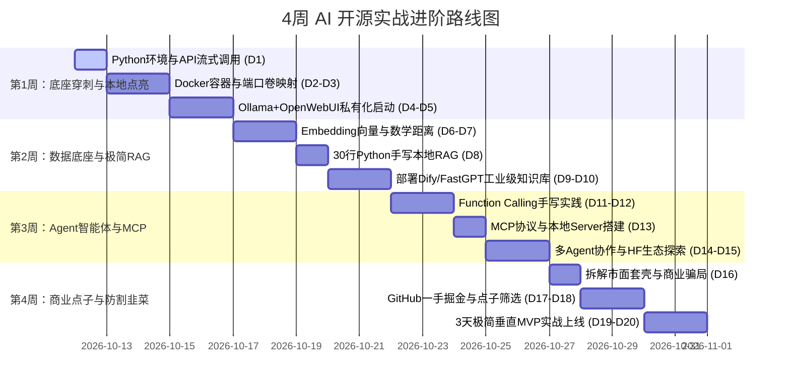

# 程序员专属 AI 与开源实战进阶体系：4周实战计划 (实战计划.md)

> **使用说明**：
> 本计划配合 [`知识清单.md`](知识清单.md) 共同使用，通过引用知识清单编号（如 `K1.1`, `K2.3` 等）执行具体任务。
> 每天规划约 **1 ~ 1.5 小时**，强调“**在终端和真实项目中跑起来**”，不做无反馈的理论空转。

---

## 阶段推进甘特图与里程碑总览



---

## 硬件分级适配指引（开练前确认）

- **分支 A（配备 NVIDIA 独显，显存 ≥ 6GB）**：
  - 本地畅玩 Ollama / vLLM，直接下载 `Qwen2.5-7B-Instruct-GGUF` 或 `DeepSeek-R1-Distill-Qwen-7B`。
- **分支 B（轻薄本 / 纯 CPU / Mac M系列）**：
  - Mac M1/M2/M3/M4：Ollama 原生支持 Metal 硬件加速，可流畅跑 7B~14B 模型；
  - 纯 Windows/Linux CPU 机器：本地仅运行 1.5B/3B 极轻量模型（如 `qwen2.5:1.5b`），繁重任务改用公网免费/极低价 API（SiliconFlow / DeepSeek）。

---

## 第一周：基础设施穿刺与大模型本地点亮 (Hello AI World)

> **本周交付物**：在本地通过 Docker 编排拉起 `Ollama + Open WebUI`，拥有完全受自己控制的私有 ChatGPT，并跑通第一段 Python 流式调用代码。

### Day 1: Python 现代极速环境与 API 流式调用
- **涉及知识点**：`K1.1`, `K1.3`, `K3.1`, `K3.3`
- **今日任务**：
  1. 安装极速 Python 包管理工具 `uv`（比传统 pip 快 10~100 倍，自动隔离环境）：
     ```powershell
     powershell -ExecutionPolicy ByPass -c "irm https://astral.sh/uv/install.ps1 | iex"
     ```
  2. 新建一个测试工程，声明依赖 `openai`, `httpx`：
     ```bash
     uv init ai-test && cd ai-test
     uv add openai
     ```
  3. 编写 `stream_call.py`，调用任意兼容 OpenAI 规范的 API（DeepSeek / SiliconFlow / 免费模型），感受流式打字机：
     ```python
     from openai import OpenAI
     client = OpenAI(api_key="your_api_key", base_url="https://api.siliconflow.cn/v1")
     response = client.chat.completions.create(
         model="Qwen/Qwen2.5-7B-Instruct",
         messages=[{"role": "user", "content": "用一句话解释为什么大模型需要流式传输"}],
         stream=True,
     )
     for chunk in response:
         content = chunk.choices[0].delta.content or ""
         print(content, end="", flush=True)
     ```
- **验收标准**：终端看到文字逐字吐出，理解 `stream=True` 与 `for chunk in response` 的流式机制。
- **AI 辅助提问 Prompt**：“请解释上面这段代码中 `delta.content` 和 `flush=True` 的作用，为什么不写 `flush=True` 会有卡顿感？”

---

### Day 2: Docker 核心概念与首个容器启动
- **涉及知识点**：`K2.1`, `K2.4`, `K3.4`
- **今日任务**：
  1. 确保 Docker Desktop（Windows/Mac）正常运行。在终端执行：
     ```bash
     docker version
     docker run --rm hello-world
     ```
  2. 体验端口映射与挂载：启动一个 Nginx 静态服务器并挂载本地 HTML：
     ```bash
     echo "<h1>Hello Open Source AI</h1>" > index.html
     docker run -d -p 8088:80 -v ${PWD}:/usr/share/nginx/html --name my-web nginx
     ```
  3. 浏览器访问 `http://localhost:8088`，修改本地 `index.html`，刷新浏览器确认内容即时生效。
- **验收标准**：理解 `-p 8088:80`（宿主机到容器端口映射）和 `-v`（数据持久化挂载），随后用 `docker rm -f my-web` 清理。

---

### Day 3: 本地大模型引擎 Ollama 穿刺
- **涉及知识点**：`K5.1`, `K5.2`, `K5.3`
- **今日任务**：
  1. 下载并安装 [Ollama](https://ollama.com/)；
  2. 启动一个轻量级开源大模型（以 Qwen2.5 为例）：
     ```bash
     ollama run qwen2.5:1.5b
     ```
     （显存 ≥ 6GB 者可直接拉取 `ollama run qwen2.5:7b`）
  3. 观察任务管理器中的 GPU / 显存 / 内存 / CPU 波动；
  4. 测试 Ollama 暴露的本地兼容 HTTP 接口：
     ```bash
     curl http://localhost:11434/api/tags
     ```
- **验收标准**：本地完全断网状态下，可在终端与该模型顺畅对话；看懂 Ollama 的监听端口为 `11434`。

---

### Day 4: Docker Compose 编排：打造私有 Open WebUI 界面
- **涉及知识点**：`K2.3`, `K2.4`, `K5.3`
- **今日任务**：
  1. 编写一份 `docker-compose.yml`，将可视化聊天前端 `Open WebUI` 与本地 `Ollama` 连接：
     ```yaml
     version: '3.8'
     services:
       open-webui:
         image: ghcr.io/open-webui/open-webui:main
         container_name: open-webui
         ports:
           - "3000:8080"
         extra_hosts:
           - "host.docker.internal:host-gateway"
         environment:
           - OLLAMA_BASE_URL=http://host.docker.internal:11434
         volumes:
           - open-webui-data:/app/backend/data
         restart: always

     volumes:
       open-webui-data:
     ```
  2. 运行 `docker compose up -d` 启动服务；
  3. 浏览器打开 `http://localhost:3000`，注册管理员账号，进入类 ChatGPT 的私有界面。
- **验收标准**：在 Web 界面选择本地下载的 Qwen 模型进行对话，体验与 ChatGPT 毫无二致的完整交互。

---

### Day 5: 第一周复盘与大模型核心参数实操
- **涉及知识点**：`K1.4`, `K5.1`, `K3.2`
- **今日任务**：
  1. 用 Day 1 的 Python 脚本，将 `base_url` 改为本地 Ollama 服务：
     ```python
     client = OpenAI(api_key="ollama", base_url="http://localhost:11434/v1")
     ```
  2. 实验改变模型参数：
     - `temperature=0.0`：测试数学与事实问答，观察回答的严谨与重复性；
     - `temperature=1.2`：测试创意写作，观察模型的发散与天马行空。
- **周末验收成果**：掌握“云端 API 与本地开源模型代码 100% 无缝切换”的技巧。

---

## 第二周：数据底座与个人专属 RAG 极简实现 (知识库不求人)

> **本周交付物**：亲手写出一段 40 行的无框架原生 Python RAG 脚本，理解向量搜索本质，并在本地运行开源企业级知识库 Dify / FastGPT。

### Day 6: 亲眼见证 Embedding：文本是如何变成数字的
- **涉及知识点**：`K4.2`
- **今日任务**：
  1. 调用 Embedding API，获取句子的向量表示：
     ```python
     from openai import OpenAI
     client = OpenAI(api_key="your_api_key", base_url="https://api.siliconflow.cn/v1")
     # 或使用本地 ollama: client = OpenAI(api_key="ollama", base_url="http://localhost:11434/v1")

     resp = client.embeddings.create(
         model="BAAI/bge-m3", # 或 ollama 的 bge-m3
         input=["西瓜很甜", "苹果很好吃", "波音737客机"]
     )
     vecs = [item.embedding for item in resp.data]
     print("向量维度:", len(vecs[0]))
     print("前5个数字:", vecs[0][:5])
     ```
- **验收标准**：直观看到每句话被转成了一个 1024 维的浮点数列表。

---

### Day 7: 纯数学余弦相似度计算（不借助复杂数据库）
- **涉及知识点**：`K4.2`, `K4.3`
- **今日任务**：
  1. 写一个极简余弦相似度函数（点积除以模长）：
     ```python
     import math
     def cosine_similarity(v1, v2):
         dot = sum(a * b for a, b in zip(v1, v2))
         norm1 = math.sqrt(sum(a * a for a in v1))
         norm2 = math.sqrt(sum(b * b for b in v2))
         return dot / (norm1 * norm2)

     sim_fruit = cosine_similarity(vecs[0], vecs[1]) # 西瓜 vs 苹果
     sim_plane = cosine_similarity(vecs[0], vecs[2]) # 西瓜 vs 波音737
     print(f"西瓜与苹果相似度: {sim_fruit:.4f}")
     print(f"西瓜与客机相似度: {sim_plane:.4f}")
     ```
- **验收标准**：看到 `西瓜与苹果` 相似度明显远高于 `西瓜与客机`，彻底破除对向量检索的玄学崇拜。

---

### Day 8: 30 行 Python 代码拼接最简 RAG 系统
- **涉及知识点**：`K6.1`, `K6.2`
- **今日任务**：
  1. 准备一段私有虚构文档（例如：“公司WiFi密码是 Alpha9988，食堂周三供应红烧牛肉”）；
  2. 实现检索增强生成链路：
     ```python
     # 1. 拆分文档
     docs = ["公司WiFi密码是 Alpha9988", "食堂周三供应红烧牛肉", "上班时间为早上9点整"]
     # 2. 向量化检索（输入问题：“食堂今天吃什么？”）
     query = "食堂周三有什么菜？"
     # 3. 匹配最相近的 doc 切片
     best_doc = docs[1] # 假设检索匹配到了这一条
     # 4. 拼装增强 Prompt
     prompt = f"参考以下已知信息：\n{best_doc}\n\n回答用户问题：{query}"
     # 5. 送入大模型生成最终回答
     ```
- **验收标准**：能够向大模型提问原本它绝对不知道的私有信息，并得到准确回答。

---

### Day 9: 部署开源成熟知识库系统 Dify 或 FastGPT
- **涉及知识点**：`K2.3`, `K6.4`
- **今日任务**：
  1. 克隆开源标杆项目（推荐体验 [Dify](https://github.com/langgenius/dify) 或 [FastGPT](https://github.com/labring/FastGPT)）：
     ```bash
     git clone https://github.com/langgenius/dify.git
     cd dify/docker
     cp .env.example .env
     docker compose up -d
     ```
  2. 进入 `http://localhost` 初始化，上传一份 PDF 或 Markdown，创建一个聊天知识库机器人。
- **验收标准**：成功跑通商业级知识库的上传、解析、检索召回与分段引用。

---

### Day 10: 第二周复盘：RAG 为什么会失败？
- **涉及知识点**：`K6.3`, `K4.4`
- **今日任务**：
  1. 测试 RAG 翻车场景：
     - 上传带有合并单元格的表格，提问交叉数据；
     - 上传带有否定逻辑的长合同，观察召回截断带来的误答；
  2. 理解“重排 (Rerank)”和“元数据过滤”为什么是商业化知识库的必经之路。
- **周末验收成果**：具备对任何市面知识库产品的诊断能力，能准确指出其缺陷所在。

---

## 第三周：探索 Agent 智能体、工具协议与开源前沿 (赋予 AI 手脚)

> **本周交付物**：让 AI 具备调用电脑外部工具的能力（Function Calling 与 MCP），拆解开源 Agent 工作流。

### Day 11: 亲手实现 Function Calling（函数调用）
- **涉及知识点**：`K7.1`, `K1.4`
- **今日任务**：
  1. 定义一个真实的本地 Python 函数（例如获取本地时间和天气）：
     ```python
     def get_weather(location: str):
         return f"{location}今天晴天，气温25度"
     ```
  2. 向模型提交 Tools JSON Schema，让模型决定是否需要调用它：
     ```python
     tools = [{
         "type": "function",
         "function": {
             "name": "get_weather",
             "description": "获取指定城市的天气",
             "parameters": {
                 "type": "object",
                 "properties": {"location": {"type": "string"}},
                 "required": ["location"]
             }
         }
     }]
     # 提问：“北京今天天气如何？需要带伞吗？”
     ```
  3. 解析模型返回的 `tool_calls`，在本地运行 `get_weather("北京")`，将结果返回给模型生成最终回复。
- **验收标准**：理解“模型负责决策参数，人类程序负责真正干活”的 Agent 核心哲学。

---

### Day 12: 深入体验 Model Context Protocol (MCP) 协议
- **涉及知识点**：`K7.2`
- **今日任务**：
  1. 理解 MCP 的 Client / Host / Server 架构；
  2. 查看一个开源 MCP Server（例如官方 `mcp/server-sqlite` 或 `mcp/server-filesystem`）；
  3. 观察 MCP 是如何用统一的 JSON-RPC 协议标准，消灭为每个不同 AI 工具重复写适配器的痛苦。
- **验收标准**：能画出 MCP 消息流转时序图（Prompt -> Host -> Client -> Server 执行 -> 结果回填）。

---

### Day 13: 拆解开源多智能体框架 LangGraph / CrewAI
- **涉及知识点**：`K7.3`
- **今日任务**：
  1. 阅读 CrewAI 或 LangGraph 的最小官方示例；
  2. 理解“角色定义 (Role/Goal)”、“任务交接 (Tasks)”与“状态图 (State Graph)”；
  3. 思考：为什么单一 Agent 在执行超过 5 个步骤时容易崩溃？多 Agent 状态机如何隔离风险？
- **验收标准**：能讲清多 Agent 并不是多个模型在聊天，而是多个带有独立上下文的 Prompt 链条在传递结构化状态。

---

### Day 14: 玩转 Hugging Face 开源宝藏库
- **涉及知识点**：`K5.4`, `K8`
- **今日任务**：
  1. 访问 `huggingface.co/models`，熟练运用标签过滤器（Tasks: Text Generation, Text-to-Image, Audio）；
  2. 使用 `huggingface_hub` 下载一个小型开源分词器或模型权重：
     ```bash
     pip install huggingface_hub
     python -c "from huggingface_hub import snapshot_download; print('Hub CLI ready')"
     ```
  3. 在 Hugging Face Spaces 体验 3 个热门免部署开源 AI 应用。
- **验收标准**：掌握在没有商业算力的情况下，如何利用 HF 免费资源探索前沿技术。

---

### Day 15: 第三周复盘：Agent 的工程幻觉与死循环防护
- **涉及知识点**：`K7.1`, `K7.3`
- **今日任务**：
  1. 分析 Agent 常见崩溃点：工具返回报错导致模型死循环重试、上下文 Token 爆炸超出窗口、Prompt 注入被绕过；
  2. 总结工程防御三铁律：强制最大步数限制（Max Steps）、结构化 JSON Schema 校验、工具超时熔断。
- **周末验收成果**：具备评判开源 Agent 框架健壮性的工程判断力。

---

## 第四周：商业点子、极速 MVP 与防割韭菜心法 (成为操盘者)

> **本周交付物**：形成一套商业识假防割雷达，并用开源组合拳在 3 天内拼装出一个可解决真实痛点的 MVP 小工具。

### Day 16: 商业识假实战：拆解市面上的“伪创新”与“割韭菜套路”
- **涉及知识点**：`K8.1`, `K8.2`
- **今日任务**：
  1. 拿市面上 3 个热门收费 AI 工具作为解剖样本：
     - 分析其宣传语与真实技术实现的差距；
     - 还原其背后的开源技术原型（如使用 NextChat + 阿里云百炼 API 包装收费）；
  2. 测算其实际运营成本：一个提问背后消耗多少 Token？成本到底是几厘钱还是几十块？
- **验收标准**：写出一篇 300 字的《商业 AI 产品底色解剖笔记》，彻底消除对商业噱头的神秘感。

---

### Day 17: GitHub Trending 淘金 SOP 与点子筛选
- **涉及知识点**：`K8.3`, `K8.4`
- **今日任务**：
  1. 建立每日/每周扫描流：
     - 打开 `github.com/trending/python?since=weekly`
     - 打开 `huggingface.co/papers`
  2. 练习“从技术找痛点”：看到一个新技术，思考它可以给哪个非程序员群体降本增效？
     - 例：开源 Whisper 语音识别 -> 律师采访录音快速转写与敏感词标记；
     - 例：开源 Qdrant 向量检索 -> 外贸多语言商品说明书精准匹配。
- **验收标准**：列出 3 个具有商业可行性的小而美技术组合点子。

---

### Day 18: 确定选型：3 天极速 MVP 架构设计
- **涉及知识点**：`K1.4`, `K2.3`, `K8.4`
- **今日任务**：
  1. 选定一个切口极窄的原型项目（如：**本地 Markdown 笔记智能周报生成器** 或 **开源简历关键技能自动对齐助手**）；
  2. 极简架构规划（坚决不重复造轮子）：
     - 前端：现成开源 WebUI（如 Streamlit、Gradio 或现成 React 模板）
     - 后端：FastAPI + 本地/云端大模型 API
     - 数据：本地 SQLite 或文件系统
- **验收标准**：写出 1 页项目 README 与架构时序图，拒绝过度设计。

---

### Day 19: 极速拼装与流水线跑通
- **涉及知识点**：`K1.1`, `K2.3`
- **今日任务**：
  1. 用 Python / Docker 快速拉起项目服务；
  2. 让 AI（如 Antigravity / Cursor）替你编写 80% 的胶水代码；
  3. 程序员亲自把关：配置跨域、环境变量加密、Docker 打包、错误兜底处理。
- **验收标准**：该 MVP 工具能够独立运行，输入一段原始数据，稳定输出高质量结构化成果。

---

### Day 20: 结营大复盘：确立你的 AI 时代底层护城河
- **涉及知识点**：全清单复盘
- **今日任务**：
  1. 回顾四周成长轨迹：
     - 从“完全看不懂开源 AI 仓库的各种配置”到“能独立用 Docker 跑起任何开源模型”；
     - 从“把大模型当神奇黑盒”到“看透 HTTP/SSE、Embedding、向量库、Function Calling 全链路”；
     - 从“容易被 AI 噱头割韭菜”到“一眼看穿商业套壳本质并能自己拼装 MVP”。
  2. 固化个人资产库（收藏的 GitHub 仓库、常用 Docker 配置文件、高频调试 Prompt）。
- **终极交付物**：拥有了在 AI 浪潮中“进可手搓架构与产品，退可穿透概念不受忽悠”的真实工程掌控力！
