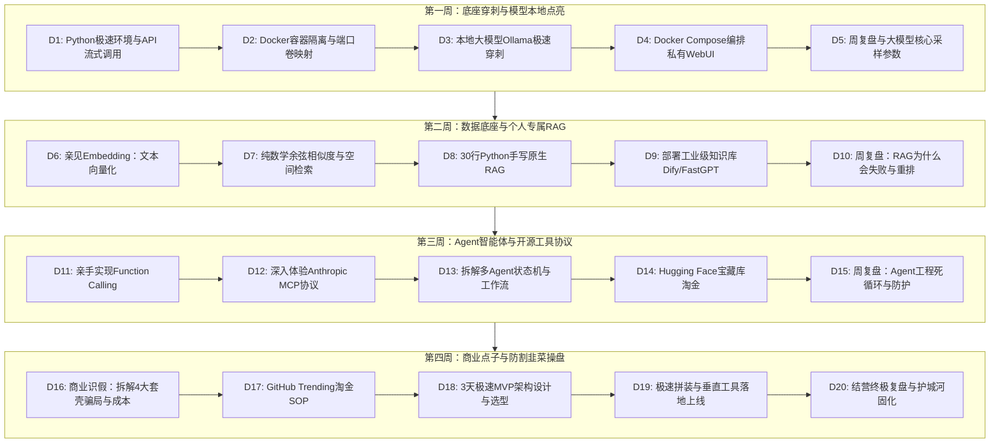

# 程序员专属 AI 与开源实战教学参考书 (总目录与全景导读)

> **核心哲学**：
> “程序员的优势在于能够很底层地使用 AI 甚至自己开发。有很多 AI 应用、模型是以代码模式放在 GitHub、Hugging Face 上的，大厂也会开放 API 给技术人员。
> **用 AI 快速学习编程底座（Python、Docker、网络、数据库）——不用精通手写，只要看懂架构；然后再尝试开源 AI 项目，在实战中持续吸收 AI 知识。建立应用视野与商业点子，坚决防被割韭菜。**”

---

## 全书知识全景与导读时序

---

## 分册导航与节点速查

| 分卷编号 | 分卷主题 | 覆盖节点 | 对应核心技术点 | 阅读入口 |
| :--- | :--- | :--- | :--- | :--- |
| **第一卷** | **基础设施穿刺与大模型本地点亮** | D1 ~ D5 | uv 环境隔离、Docker 容器化、Ollama 本地推理、Open WebUI 编排、流式 SSE 协议 | [第一周教学参考书](第一周_底座穿刺与模型本地点亮.md) |
| **第二卷** | **数据底座与个人专属 RAG 极简实现** | D6 ~ D10 | 向量嵌入 Embedding、余弦相似度、原生手写 RAG、Dify 工业级知识库、Rerank 重排 | [第二周教学参考书](第二周_数据底座与个人专属RAG极简实现.md) |
| **第三卷** | **Agent 智能体与开源工具协议** | D11 ~ D15 | Function Calling、ReAct 循环、Anthropic MCP 协议标准、LangGraph、Hugging Face | [第三周教学参考书](第三周_Agent智能体与开源工具协议.md) |
| **第四卷** | **商业点子孵化与防割韭菜操盘手册** | D16 ~ D20 | 商业套壳成本逆向、一手开源信息雷达、MVP 敏捷选型、开源组合拳上线、技术壁垒 | [第四周教学参考书](第四周_商业点子孵化与防割韭菜操盘手册.md) |

---

## 学习者食用指南（如何高效使用本书）

1. **“不用会，只要懂”的阅读姿态**：
   - 遇到代码片段，**不要**逐行死抠语法细节，把重点放在“输入是什么、经过什么转换、输出是什么”。
   - 让 AI 编码助手负责写具体语法，你负责审查入参、出参和架构边界。
2. **每个节点配套的实战闭环**：
   - 本书每一节均按照 **【核心理念】 -> 【深度原理解析】 -> 【极简核心代码/命令】 -> 【AI 提问 Prompt 范式】 -> 【避坑排错指南】 -> 【验收小试炼】** 展开。
   - 坚持“边看、边复制命令在终端执行、边找 AI 追问不懂的点”，1 小时内搞定一个节点。
3. **保持技术清醒，抵御焦虑与割韭菜**：
   - 牢记：市面上卖成百上千元的“AI 神器”与“内部秘籍”，99% 的底层技术都在这 4 本参考书所覆盖的开源代码中完全公开且免费。
