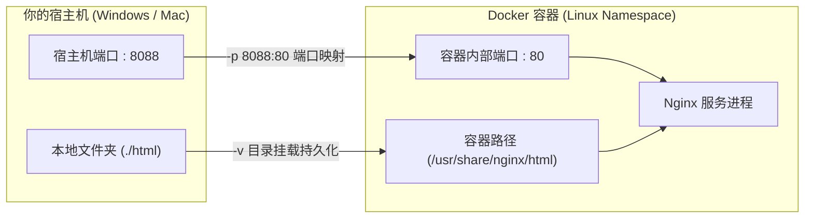
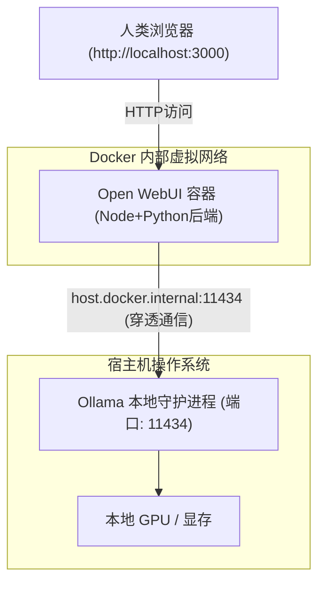
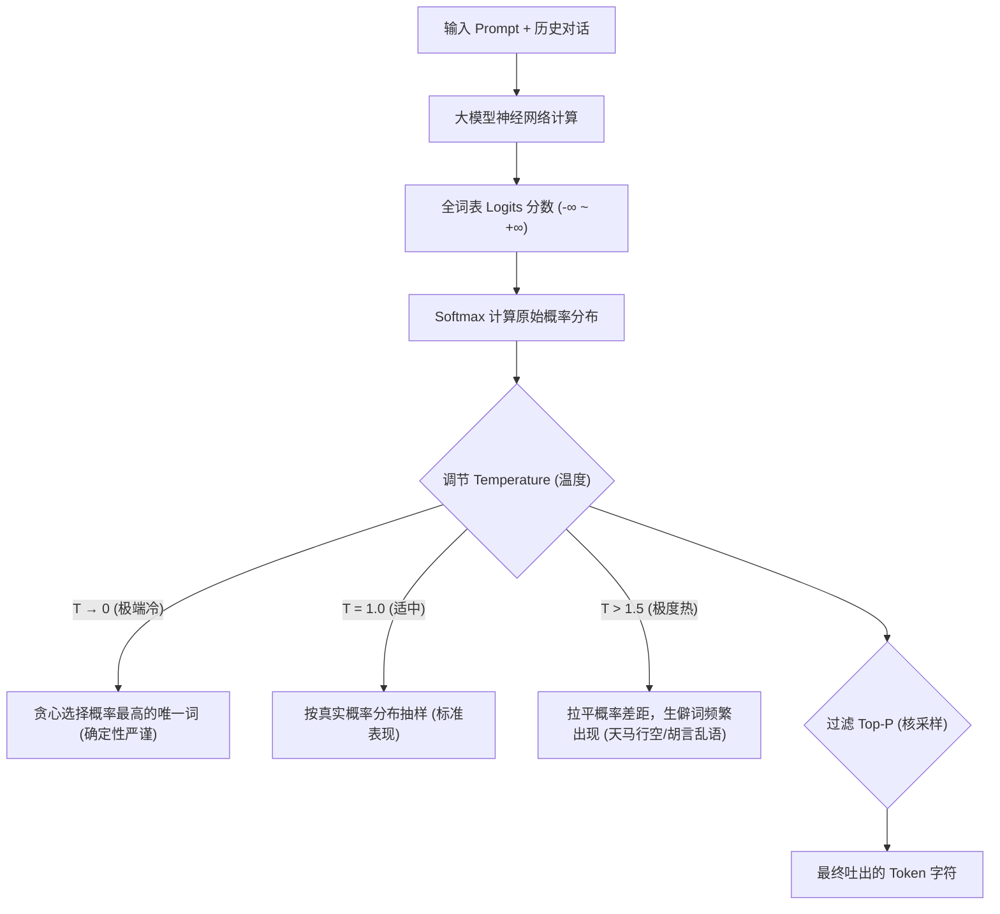

# 第一周：基础设施穿刺与大模型本地点亮 (教学参考书)

> **本周核心心智模型**：
> “代码不用自己死记硬背手写，但必须看透数据流向与系统架构。第一周的目标是消灭对环境、容器和本地模型的恐惧，建立‘在自己电脑上拥有完整 AI 算力与服务’的第一体感。”

---

## 目录
- [Day 1: Python 极速环境管理与 API 流式调用](#day-1-python-极速环境管理与-api-流式调用)
- [Day 2: Docker 容器技术与服务隔离交付](#day-2-docker-容器技术与服务隔离交付)
- [Day 3: 本地开源大模型引擎 Ollama 穿刺](#day-3-本地开源大模型引擎-ollama-穿刺)
- [Day 4: Docker Compose 编排：打造私有 Open WebUI 界面](#day-4-docker-compose-编排打造私有-open-webui-界面)
- [Day 5: 第一周工程复盘与模型核心采样参数](#day-5-第一周工程复盘与模型核心采样参数)

---

## Day 1: Python 极速环境管理与 API 流式调用

### 1. 核心理念（为什么学，怎么看透）
在 AI 时代，Python 是全球公认的“胶水语言”。95% 的顶级 AI 论文、开源项目、大厂 API SDK 都是首选 Python 发布的。
**但绝大多数新手（甚至传统前端/Java 工程师）切入 AI 时遇到的第一只拦路虎，不是算法，而是“环境冲突”**：全局安装的 Python 库版本打架、系统自带 Python 被污染、依赖下载极慢。
我们今天不学语法糖，只学两件事：
1. **用新一代工程神器 `uv` 彻底实现秒级环境隔离**；
2. **看懂大模型 API 的本质与打字机流式输出（SSE）的底层通信链路**。

---

### 2. 深度原理解析

#### (1) Python 虚拟环境隔离的物理本质
所谓的“虚拟环境（Virtual Environment）”，本质上就是在某个文件夹下放了一个独立的 Python 解释器替身和独立的 `site-packages`（依赖库存储目录）。
- 传统做法：`pip install` 经常往全局系统目录塞东西，A 项目要 `numpy 1.20`，B 项目要 `numpy 2.0`，直接系统级崩溃。
- 现代做法：使用 Rust 编写的 `uv` 工具，每个项目在当前目录创建独立的 `.venv/`。删除 `.venv/` 目录就等于彻底卸载，对操作系统零污染，且下载速度比传统 pip 快 10~100 倍。

#### (2) 大模型流式输出（Streaming）的通信底座：SSE (Server-Sent Events)
大模型生成文字不是“一次性全部写完再返回”，而是一个 Token 接一个 Token 依次预测出来的（Next-token prediction）。
- **如果用普通 HTTP**：必须等待 20 秒，模型把 1000 个字全生成完毕，客户端才能看到结果，用户体验极差。
- **SSE 长连接技术**：客户端发起一个标准的 HTTP POST 请求，并在请求头声明 `Accept: text/event-stream`。服务端保持连接不断开，每生成一个词，就顺着同一个 TCP 连接推送一行：
  ```http
  data: {"choices": [{"delta": {"content": "你"}}]}
  data: {"choices": [{"delta": {"content": "好"}}]}
  data: [DONE]
  ```
- 客户端的 Python 代码通过**生成器（Generator）**或异步迭代器实时读取这个管道里的每一滴水，终端就呈现出一字一字的打字机效果。

---

### 3. 极简核心代码与实验

#### 步骤 1：安装 `uv` 并在本地建立测试环境
在 Windows PowerShell 或 Linux/macOS 终端执行：
```powershell
# Windows 安装 uv
powershell -ExecutionPolicy ByPass -c "irm https://astral.sh/uv/install.ps1 | iex"
```
验证安装：
```bash
uv --version
```

#### 步骤 2：创建独立测试工程并声明依赖
```bash
uv init ai-stream-lab && cd ai-stream-lab
uv add openai httpx
```
执行后你会发现当前目录下生成了 `pyproject.toml` 和 `.venv/` 文件夹。

#### 步骤 3：编写极简流式调用脚本 `stream_demo.py`
```python
import os
import sys
from openai import OpenAI

# 1. 实例化客户端（OpenAI SDK 已成为全球大模型接口事实标准）
# 可替换为 SiliconFlow、DeepSeek、阿里云百炼或本地 Ollama 的地址
client = OpenAI(
    api_key=os.getenv("LLM_API_KEY", "sk-your-api-key"),
    base_url=os.getenv("LLM_BASE_URL", "https://api.siliconflow.cn/v1")
)

def run_stream_chat(prompt: str):
    print(f"\n[用户提问]: {prompt}\n[AI思考并流式回答]: ", end="", flush=True)

    # 2. 发起流式请求：核心关键在于 stream=True
    response = client.chat.completions.create(
        model="Qwen/Qwen2.5-7B-Instruct",
        messages=[
            {"role": "system", "content": "你是一名精通底层计算机架构的高级架构师，回答精炼通俗。"},
            {"role": "user", "content": prompt}
        ],
        stream=True  # 开启 SSE 流式推送
    )

    # 3. 迭代消费数据流
    for chunk in response:
        # 获取当前片段吐出的增量文字
        delta = chunk.choices[0].delta.content or ""
        # flush=True 强制立即刷新系统标准输出缓冲区，杜绝终端文字滞后
        sys.stdout.write(delta)
        sys.stdout.flush()
    print("\n\n[流式传输结束]")

if __name__ == "__main__":
    run_stream_chat("为什么说程序员学习大模型应该‘不用会，只要懂’？请用三句话回答。")
```

运行测试：
```bash
uv run python stream_demo.py
```

---

### 4. AI 助学提问 Prompt 范式
当你遇到任何疑问时，复制以下 Prompt 喂给 AI：
> “我是一名程序员，刚用 `openai-python` SDK 跑通了 `stream=True` 的流式代码。请用计算机网络底层时序图向我解释：从发起 HTTP POST 请求到服务端推送第一条 SSE 数据，底层 TCP 连接经历了什么？客户端为什么不需要重新发起握手？”

---

### 5. 常见踩坑与排错指南
1. **报错 `PowerShell 无法加载脚本，因为在此系统上禁止运行脚本`**：
   - **原因**：Windows 默认执行策略限制。
   - **解法**：在 PowerShell 执行 `Set-ExecutionPolicy -Scope CurrentUser RemoteSigned` 即可。
2. **终端打印文字出现奇怪卡顿，不是一字一字吐，而是一大段一大段蹦**：
   - **原因**：Python 的 `sys.stdout` 在非交互式终端有缓冲机制。
   - **解法**：必须在 `print()` 中加上 `flush=True`，或设置环境变量 `PYTHONUNBUFFERED=1`。
3. **报错 `AuthenticationError: 401 Unauthorized`**：
   - **原因**：API Key 填错或未开通权限，检查请求头中的 Bearer Token。

---

### 6. 验收小试炼
- [ ] 成功使用 `uv` 独立创建项目，不污染任何全局 Python 目录；
- [ ] 亲眼看到终端里文字一字一顿实时吐出；
- [ ] 能够用白话给非技术同事讲清楚“为什么 ChatGPT 不是等 20 秒才返回全部答案”。

---

## Day 2: Docker 容器技术与服务隔离交付

### 1. 核心理念（为什么学，怎么看透）
开源 AI 社区里流传着一句名言：“**如果一个 AI 项目没有提供 Docker 镜像或 Dockerfile，它的实际可用性直接打三折**”。
因为一个典型的 AI 项目通常包含：复杂的 C++ 编译环境、特定版本的 PyTorch、特定版本的 NVIDIA CUDA 驱动、十几项底层系统依赖。
**Docker 就是给这个项目打包了一台‘带完整操作系统的微型电脑’。在谁的电脑上跑，都 100% 表现一致。**

---

### 2. 深度原理解析



#### (1) 镜像（Image）与容器（Container）的本质
- **镜像 (Image)**：就像一张只读的**系统安装光盘**（或者游戏光盘），里面刻录了完整的系统文件、依赖包和代码。它是静态的、只读的。
- **容器 (Container)**：把这张光盘放进光驱，点击运行，内存里就跑起了一个隔离的进程实例。
- **核心铁律**：容器一旦被销毁，容器内部新增的文件默认会灰飞烟灭！所以必须通过 **Volume / 挂载卷** 把关键数据保存在宿主机硬盘上。

#### (2) 端口映射 (`-p`) 与数据卷 (`-v`)
- **端口映射 `-p 8088:80`**：容器内部有自己的独立虚拟网卡。外面的浏览器无法直接访问容器内的 `80` 端口。通过端口映射，告诉宿主机操作系统：**凡是访问我宿主机 8088 端口的流量，统统转发到容器的 80 端口**。
- **数据挂载 `-v ./my-data:/app/data`**：把宿主机当前目录的 `my-data` 穿透映射到容器内。你在宿主机修改文件，容器立刻能读到；容器写入的文件，也会实打实保存在你的物理硬盘上。

---

### 3. 极简核心代码与实验

#### 步骤 1：验证 Docker 守护进程运行
打开终端执行：
```bash
docker version
```
只要客户端和服务端都输出版本号，说明 Docker 引擎正常。

#### 步骤 2：实操启动一个 Nginx 静态服务并挂载本地文件
1. 创建本地测试目录与网页：
   ```bash
   mkdir docker-lab && cd docker-lab
   echo "<h1>Hello! Docker AI Lab Running Success.</h1>" > index.html
   ```
2. 单行命令启动 Nginx 容器：
   ```bash
   docker run -d --name test-nginx -p 8088:80 -v ${PWD}:/usr/share/nginx/html nginx
   ```
   *命令解剖：*
   - `-d`：后台静默运行（Detached 模式）；
   - `--name test-nginx`：给这个容器起个可读的名字；
   - `-p 8088:80`：把电脑的 8088 端口映射到容器内 80 端口；
   - `-v ${PWD}:/usr/share/nginx/html`：把当前物理目录挂载为 Nginx 的网页根目录。

3. 验证与热更新：
   - 打开浏览器访问：`http://localhost:8088`，看到网页显示；
   - 在本地用记事本修改 `index.html` 内容，刷新浏览器，立刻看到新内容生效！
   - 理解：这就是数据卷挂载的魅力。

4. 优雅清理容器：
   ```bash
   docker stop test-nginx
   docker rm test-nginx
   ```

---

### 4. AI 助学提问 Prompt 范式
> “我刚完成了 Docker 的端口映射和文件挂载实验。请用白话告诉我：如果一个开源 AI 项目要求运行在 Docker 容器中，但我需要把本地下载好的 15GB 大模型权重文件提供给它读取，我应该使用什么样的 `-v` 挂载参数？为什么绝不能把这 15GB 拷贝进镜像里？”

---

### 5. 常见踩坑与排错指南
1. **报错 `bind: address already in use`**：
   - **原因**：宿主机的端口（例如 8088）已经被别的程序占用了。
   - **解法**：换一个没被占用的宿主机端口，比如 `-p 8099:80`。
2. **Windows 下报错 `The command failed because the docker daemon is not running`**：
   - **原因**：Docker Desktop 软件还没彻底启动完成。
   - **解法**：点击桌面 Docker Desktop 图标，等待左下角图标变成绿色 `Engine Running`。

---

### 6. 验收小试炼
- [ ] 能够解释 `-p` 和 `-v` 参数分别代表什么；
- [ ] 成功在浏览器通过 `localhost` 访问到容器内提供的 Web 服务；
- [ ] 理解为什么后面部署开源大模型必须使用数据卷挂载模型权重。

---

## Day 3: 本地开源大模型引擎 Ollama 穿刺

### 1. 核心理念（为什么学，怎么看透）
很多非程序员以为“大模型只能联网调百度的文心或 OpenAI 的 GPT”。
程序员必须清楚：**顶级的开源大模型（如阿里开源的 Qwen2.5 系列、Meta 的 Llama-3、DeepSeek 开源的各种权重）就静静躺在 GitHub 和 Hugging Face 上，任何人都可以免费下载到自己的电脑上断网运行！**
而 **Ollama** 就是目前全球最火、最轻量、体验最丝滑的本地大模型运行引擎。

---

### 2. 深度原理解析

#### (1) 模型显存算力法则（买卡/选模型防坑必背）
大模型的本质就是一大堆**浮点数权重参数**。
- **FP16（半精度浮点）**：每个参数占 2 个字节（Byte）。一个 70 亿参数（7B）的未量化模型，光权重就需要：$7 \times 10^9 \times 2 \approx 14 \text{ GB}$ 显存！
- **量化技术（Quantization，如 GGUF / 4-bit）**：通过数学压缩，把每个参数从 16 位浮点数压缩到 4 位整数，体积直接缩小 70%，而语义智商损失极小！
- **极简显存估算黄金公式**：
  $$\text{4-bit 模型显存占用} \approx \text{参数量 (B)} \times 0.75 \text{ GB} + 1.5 \text{ GB (上下文窗口内存)}$$
  - 1.5B 模型：只需约 1.5GB 内存/显存（任何老爷机 CPU 都能秒跑）；
  - 7B 模型：只需约 5.5GB ~ 6GB 显存（RTX 3060 / 4060 畅跑）；
  - 14B 模型：需约 10GB ~ 12GB 显存；
  - 70B 模型：需约 40GB 显存（需要高端双卡或专业工作站）。

#### (2) Ollama 的运行架构
Ollama 基于底层著名的纯 C/C++ 推理库 `llama.cpp` 进行了工程封装。
- 它在后台启动一个常驻服务，默认监听 `http://localhost:11434`；
- 它原生实现了一套与 OpenAI 规范 100% 兼容的 HTTP 接口；
- **核心优势**：你写代码调用 OpenAI 时，只需把 `base_url` 改成 `http://localhost:11434/v1`，代码一行都不用改，就能无缝切换为全本地离线模型！

---

### 3. 极简核心代码与实验

#### 步骤 1：下载并运行 Ollama
1. 访问 [ollama.com](https://ollama.com/) 下载并安装 Windows/Mac 客户端；
2. 打开终端，拉取并运行阿里开源的顶流小模型 `qwen2.5:1.5b`（轻薄本或任何 CPU 均可毫无压力运行）：
   ```bash
   ollama run qwen2.5:1.5b
   ```
   *(如果你有 6GB+ 显存的独显，强烈推荐拉取 `ollama run qwen2.5:7b`)*
3. 终端出现交互提示符后，随便输入：“用Python写一个冒泡排序”，观察输出速度。
4. 输入 `/bye` 退出交互模式。

#### 步骤 2：用网络命令行验证其标准的 REST API 接口
在另一个终端执行原生 HTTP 调用：
```bash
curl http://localhost:11434/api/generate -d '{
  "model": "qwen2.5:1.5b",
  "prompt": "你好，请用一句话证明你正在本地运行",
  "stream": false
}'
```
你会收到标准的 JSON 格式返回，包含模型吐出的文本和耗时统计。

#### 步骤 3：用 Day 1 的 Python 脚本直连本地 Ollama
修改 Day 1 脚本里的配置：
```python
client = OpenAI(
    api_key="ollama",  # 本地不需要真实 Key，填任意非空字符串
    base_url="http://localhost:11434/v1"  # 指向本地 Ollama
)
# 运行后你会发现，你的 Python 脚本正完全脱离互联网，在本地跑大模型！
```

---

### 4. AI 助学提问 Prompt 范式
> “我刚在本地跑通了 Ollama 的 Qwen2.5 模型。请帮我拆解：当模型在推理时，GPU 显存里存放的主要是哪两部分数据？为什么对话历史越长，模型消耗的显存和内存会逐渐上升（什么是 KV Cache）？”

---

### 5. 常见踩坑与排错指南
1. **Ollama 默认把几十 GB 的模型下载在 C 盘系统盘，导致 C 盘爆满**：
   - **解法**：在 Windows 系统环境变量中添加用户变量 `OLLAMA_MODELS`，值为你的 D 盘或 E 盘路径（如 `D:\ollama_models`），重启终端和 Ollama 客户端即可。
2. **执行 `ollama run` 速度极慢，每秒只能吐 1 个字**：
   - **原因**：模型太大溢出了显存，或者你的电脑没有独立显卡，降级成了纯 CPU 软解。
   - **解法**：换用更小的量化模型（如从 7B 换成 1.5B 或 3B）。

---

### 6. 验收小试炼
- [ ] 本地断开 Wi-Fi 之后，依然能通过命令行与 Ollama 模型顺畅对话；
- [ ] 能用 `curl` 命中本地 `11434` 端口拿到 JSON 响应；
- [ ] 能向朋友解释 7B 模型为什么大约需要 6GB 显存。

---

## Day 4: Docker Compose 编排：打造私有 Open WebUI 界面

### 1. 核心理念（为什么学，怎么看透）
终端黑框框对话体验并不好，非技术人员也无法使用。
很多商业公司把开源模型 + 一个好看的前端界面打包一下，就敢卖成百上千元。
今天我们要用 **Docker Compose 多服务编排**，把全球最著名的开源大模型 Web 前端 **Open WebUI** 与本地的 **Ollama** 串联起来，**3 分钟搭建一套完全媲美 ChatGPT Plus 的私有 AI 工作台**！

---

### 2. 深度原理解析



#### (1) 什么是 Docker Compose？
单个容器用 `docker run` 还能应付，但一旦系统包含前端、后端、数据库、缓存时，敲一大堆命令行参数极易出错。
**Docker Compose 就是一份用 YAML 语法书写的“自动化部署总图纸”**。只需一条 `docker compose up -d`，系统就会自动按照配置拉取所有镜像、创建虚拟局域网、挂载目录并按依赖顺序启动全部服务。

#### (2) 跨网络打通的关键：`host.docker.internal`
- 痛点：Open WebUI 运行在 Docker 容器内部的隔离网络，而 Ollama 运行在宿主机的系统进程中。容器里的 `localhost` 指的是容器自己，不是你的物理电脑！
- 解法：Docker 提供了特殊的内置 DNS 域名 `host.docker.internal`，容器内部通过访问这个域名，就能精准命中宿主机物理电脑上监听的端口。

---

### 3. 极简核心代码与实验

#### 步骤 1：新建部署工程目录
```bash
mkdir openwebui-lab && cd openwebui-lab
```

#### 步骤 2：编写 `docker-compose.yml`
新建文件 `docker-compose.yml`，填入以下工业级标准配置：
```yaml
version: '3.8'

services:
  open-webui:
    image: ghcr.io/open-webui/open-webui:main
    container_name: open-webui
    ports:
      - "3000:8080"  # 宿主机访问 3000 端口，映射到容器内 8080
    extra_hosts:
      # 允许容器内部通过 host.docker.internal 访问宿主机上的 Ollama 服务
      - "host.docker.internal:host-gateway"
    environment:
      - OLLAMA_BASE_URL=http://host.docker.internal:11434
    volumes:
      # 数据持久化：保存你的聊天记录、知识库和用户配置
      - open-webui-data:/app/backend/data
    restart: always

volumes:
  open-webui-data:
```

#### 步骤 3：一键点火启动与体验
1. 在当前目录下执行一键启动：
   ```bash
   docker compose up -d
   ```
2. 查看容器运行日志（可选）：
   ```bash
   docker compose logs -f
   ```
3. 打开浏览器访问：`http://localhost:3000`；
4. 首次访问会提示注册管理员账号（本地完全离线，随便填写邮箱密码）；
5. 登录后，顶部模型下拉框会自动出现你在 Day 3 下载好的 `qwen2.5:1.5b`（或 7b）！
6. 开始沉浸式对话，体验代码高亮、Markdown 渲染、多轮历史对话管理。

---

### 4. AI 助学提问 Prompt 范式
> “我刚通过 docker-compose 把 Open WebUI 和 Ollama 串起来了。请解释：如果我想在另一台处于同一个局域网（家庭 WiFi）下的 iPad 或手机上访问我电脑上的这套 Web 界面，我需要怎么配置 IP 和防火墙端口？”

---

### 5. 常见踩坑与排错指南
1. **界面打开了，但模型下拉列表是空的，提示 `WebUI could not connect to Ollama`**：
   - **原因**：Ollama 默认只允许 `127.0.0.1` 访问，拒绝了来自 Docker 虚拟网卡的请求。
   - **解法**：在 Windows 环境变量中添加 `OLLAMA_HOST=0.0.0.0:11434`，重启 Ollama 服务，允许局域网/网关连接。
2. **下载 `ghcr.io` 镜像速度极慢超时**：
   - **原因**：GitHub 镜像源国内访问受限。
   - **解法**：配置 Docker Desktop 的镜像加速源（Registry Mirrors）。

---

### 6. 验收小试炼
- [ ] 掌握 `docker compose up -d`（启动）与 `docker compose down`（安全停止）命令；
- [ ] 在漂亮的 Web 界面下，完成至少 3 次多轮连续对话测试；
- [ ] 关掉电脑重启后，再次打开浏览器验证聊天历史依然完好无损（验证持久化）。

---

## Day 5: 第一周工程复盘与模型核心采样参数

### 1. 核心理念（为什么学，怎么看透）
很多初学者调用大模型时，只会无脑传一个 `prompt`，遇到大模型胡说八道或者回答呆板，就归咎于“大模型不行”。
**程序员必须懂得调节大模型的‘旋钮’（采样超参数）**。大模型输出下一个词时，算出来的其实是所有字典词汇的**概率分布**。到底选哪一个词，完全取决于你设置的数学采样规则。

---

### 2. 深度原理解析



#### (1) 核心参数三剑客白话拆解
1. **Temperature（采样温度）**：
   - 物理意义：调节概率分布的“陡峭程度”。
   - **低温度（0.0 ~ 0.2）**：让最高概率的词优势无限放大（类似绝对理性）。适合做：**数学计算、代码生成、SQL 查询、严格事实提取**。
   - **高温度（0.8 ~ 1.2）**：把各个候选词的概率差距缩小，冷门词也有机会被选中。适合做：**头脑风暴、故事创作、起名字、文案发散**。
2. **Top-P（Nucleus Sampling，核采样）**：
   - 规则：只在累计概率达到 $P$ 的候选词集合里选。
   - 例如设 `top_p = 0.9`，模型会先把概率从高到低排，当加起来达到 90% 时，把剩下 10% 的那些极端冷门词强行抹除，防止模型突然冒出乱码或外星语。
3. **System Prompt（系统角色设定）**：
   - 大模型本质上是无头绪的“补全机器”。System Prompt 会在整个注意力计算的最前列注入高权重偏置，决定了模型的“人格与输出边界”。

---

### 3. 极简核心代码与实验

#### 编写对比实验脚本 `sampling_lab.py`
```python
import os
from openai import OpenAI

client = OpenAI(
    api_key=os.getenv("LLM_API_KEY", "ollama"),
    base_url=os.getenv("LLM_BASE_URL", "http://localhost:11434/v1")
)

test_prompt = "请为一个卖‘程序员养生防脱发护眼枸杞茶’的品牌，起 3 个极具创意的产品名字。"

def test_sampling(temp: float):
    print(f"\n" + "="*50)
    print(f"正在测试 Temperature = {temp}")
    print("="*50)
    resp = client.chat.completions.create(
        model="qwen2.5:1.5b",  # 或 7b
        messages=[{"role": "user", "content": test_prompt}],
        temperature=temp,
        max_tokens=200
    )
    print(resp.choices[0].message.content)

if __name__ == "__main__":
    # 实验 1：极低温度（观察答案的平实、规整）
    test_sampling(0.0)
    # 实验 2：极高温度（观察词汇的发散与脑洞）
    test_sampling(1.3)
```

---

### 4. 第一周全景回顾与里程碑核销

```
[第 1 周里程碑自检卡]
├── [x] K1: Python 极速工具链 (uv) 跑通，完成首个 stream=True 流式调用
├── [x] K2: Docker 容器生命周期掌握，吃透端口映射 (-p) 与卷挂载 (-v)
├── [x] K3: 攻克 Ollama 本地推理运行时，算透大模型显存估算黄金公式
├── [x] K4: Docker Compose 成功编排 Open WebUI，私有离线 ChatGPT 正式投产
└── [x] K5: 掌握 Temperature / Top-P 采样超参对大模型输出特性的决定性影响
```
恭喜你！到这里，你已经不再是一个只会看科技新闻的旁观者，你的物理电脑上已经拥有了完全受控、开箱即用的 AI 工业底座。
下一周，我们将用这个底座，跨入大模型应用最核心的技术生命线——**向量数据库与 RAG 个人专属知识库**！
