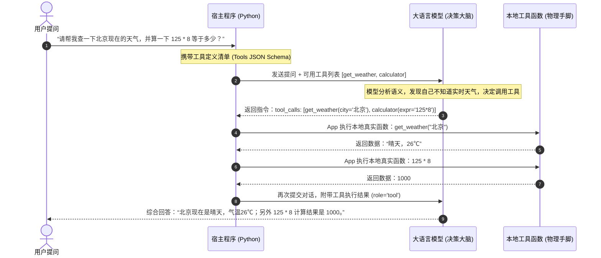
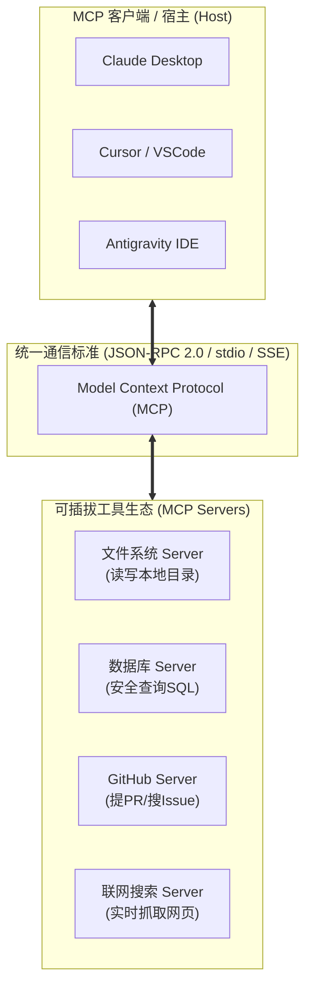
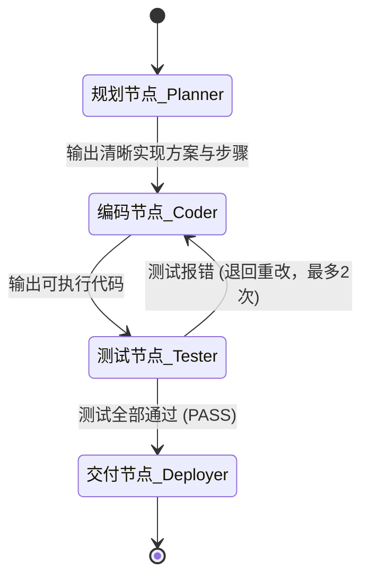
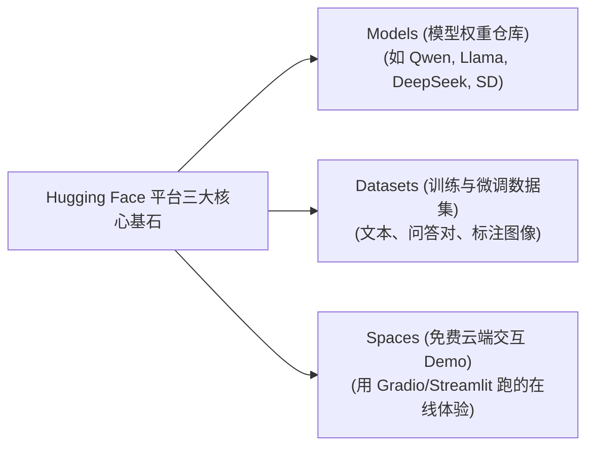

# 第三周：Agent 智能体与开源工具协议 (教学参考书)

> **本周核心心智模型**：
> “纯聊天的大模型只是‘缸中之脑’，它既不能联网，也不能操作电脑。Agent（智能体）的本质是给大脑接上‘眼睛和手脚’。本周我们将亲手实现 Function Calling 函数调用，攻克行业事实标准 MCP 协议，并掌握开源 Agent 的防崩溃工程设计。”

---

## 目录
- [Day 11: 亲手实现 Function Calling（函数调用）](#day-11-亲手实现-function-calling函数调用)
- [Day 12: 深入体验 Model Context Protocol (MCP) 协议](#day-12-深入体验-model-context-protocol-mcp-协议)
- [Day 13: 拆解开源多智能体框架 LangGraph / CrewAI](#day-13-拆解开源多智能体框架-langgraph--crewai)
- [Day 14: Hugging Face 宝藏库淘金](#day-14-hugging-face-宝藏库淘金)
- [Day 15: 第三周工程复盘：Agent 的工程幻觉与防死循环设计](#day-15-第三周工程复盘agent-的工程幻觉与防死循环设计)

---

## Day 11: 亲手实现 Function Calling（函数调用）

### 1. 核心理念（为什么学，怎么看透）
很多非程序员有一种迷信，以为大模型能够“自己运行 Python 脚本”或者“自己登录数据库查询”。
**作为程序员，必须彻底破除这种迷信：大模型自己绝对不会执行任何真实代码！它能做且仅能做的一件事，就是生成文本！**
那么，AI 到底是怎么帮我们查天气、搜数据库、下发邮件的？
答案就是：**Function Calling（函数调用协议）**。大模型做的是“决策与参数提取”，你的程序做的是“真正的物理执行”。

---

### 2. 深度原理解析



#### ReAct 循环的核心本质：
1. **思考 (Reason)**：模型根据当前上下文，判断当前问题是否需要工具介入；
2. **行动 (Act)**：模型输出标准 JSON，指明工具名称与结构化参数；
3. **观察 (Observe)**：外部程序把工具执行的真实结果塞回给模型；
4. **总结或再次行动**：模型根据新信息得出最终回答，或者决定继续调用下一个工具。

---

### 3. 极简核心代码与实验

#### 编写全功能原生函数调用脚本 `function_calling_lab.py`
```python
import json
import os
from openai import OpenAI

client = OpenAI(
    api_key=os.getenv("LLM_API_KEY", "sk-your-api-key"),
    base_url=os.getenv("LLM_BASE_URL", "https://api.siliconflow.cn/v1")
)

# 1. 定义我们本地真实要执行的 Python 函数（大模型摸不到这块内存）
def get_current_weather(city: str) -> str:
    """本地真实天气查询函数（模拟返回）"""
    weather_db = {
        "北京": "晴空万里，气温 24℃，东南风2级",
        "上海": "阴有小雨，气温 20℃，湿度 85%",
        "深圳": "多云间晴，气温 28℃，体感舒适"
    }
    return weather_db.get(city, f"{city}的天气暂时未查到。")

# 2. 用标准 JSON Schema 向模型描述这个工具长什么样
tools_definition = [
    {
        "type": "function",
        "function": {
            "name": "get_current_weather",
            "description": "查询指定城市的当前实时天气情况",
            "parameters": {
                "type": "object",
                "properties": {
                    "city": {
                        "type": "string",
                        "description": "城市名称，如：北京、上海、深圳"
                    }
                },
                "required": ["city"]
            }
        }
    }
]

def run_agent_loop(user_query: str):
    print(f"\n[用户]: {user_query}")
    messages = [{"role": "user", "content": user_query}]

    # 第一轮交互：把问题和工具清单一起送给模型
    response = client.chat.completions.create(
        model="Qwen/Qwen2.5-7B-Instruct",
        messages=messages,
        tools=tools_definition,
        tool_choice="auto"  # 让模型自主决定用不用工具
    )

    msg = response.choices[0].message
    messages.append(msg)

    # 检查模型是否决定调用工具
    if msg.tool_calls:
        for tool_call in msg.tool_calls:
            func_name = tool_call.function.name
            func_args = json.loads(tool_call.function.arguments)
            print(f" -> [模型发出工具调用申请]: 函数={func_name}, 参数={func_args}")

            # 宿主程序执行真正的物理逻辑
            if func_name == "get_current_weather":
                real_result = get_current_weather(city=func_args.get("city"))
                print(f" -> [本地函数执行完毕，得到真实结果]: {real_result}")

                # 将工具执行结果作为 'tool' 角色追加到消息历史
                messages.append({
                    "role": "tool",
                    "tool_call_id": tool_call.id,
                    "content": real_result
                })

        # 第二轮交互：将带有工具结果的消息历史再次提交给模型，生成最终人话总结
        final_response = client.chat.completions.create(
            model="Qwen/Qwen2.5-7B-Instruct",
            messages=messages
        )
        print(f"[AI 最终总结回复]:\n{final_response.choices[0].message.content}\n")
    else:
        print(f"[AI 直接回答无需工具]:\n{msg.content}\n")

if __name__ == "__main__":
    # 测试用例 1：触发天气工具
    run_agent_loop("请问上海现在天气怎么样？出门需要带雨伞吗？")
    # 测试用例 2：不触发工具的普通对话
    run_agent_loop("请用李白的豪迈风格写一首四句唐诗。")
```

---

### 4. AI 助学提问 Prompt 范式
> “我刚亲手实现了 Function Calling 的完整闭环。请向我解释：如果模型在第一轮返回参数时，参数格式不符合我的 Python 要求（例如把数字传成了字符串），业界常见的容错重试策略是什么？Pydantic 是如何介入这层参数校验的？”

---

### 5. 验收小试炼
- [ ] 亲眼看到终端打印出 `模型发出工具调用申请` 的 JSON 参数；
- [ ] 在脚本中增加第二个工具 `calculator(expr: str)`，测试让模型在一个提问中同时调用天气和计算器两个函数。

---

## Day 12: 深入体验 Model Context Protocol (MCP) 协议

### 1. 核心理念（为什么学，怎么看透）
在 Day 11 中，你为了让大模型调一个天气函数，手动手写了一大堆 JSON Schema 和 Python 映射逻辑。
试想一下：全球有 1000 种 AI 客户端（Cursor、Claude Desktop、Antigravity、ChatGPT、VSCode），有 10 万个工具（查询 GitHub、操作本地文件、读写 MySQL、控制智慧家居）。
**如果每个工具都要为每款 AI 客户端单独写一套适配插件，整个生态将陷入灾难性的碎片化！**
**Anthropic 开源的 MCP（Model Context Protocol）协议，就是 AI 时代的“Type-C / USB 标准”！**
一个工具只要写一次 MCP Server，任何支持 MCP 协议的 AI 客户端都能一键即插即用！

---

### 2. 深度原理解析



#### (1) MCP 的三层架构
1. **Host（宿主）**：发起人。例如你的 Cursor 或 Antigravity 客户端，负责与人类交互、拥有大模型连接。
2. **Client（协议客户端）**：宿主内部负责与 MCP Server 建立连接的协议层模块。
3. **Server（工具服务端）**：一个独立运行的轻量进程。它向 Client 声明：“我支持读取文件 `read_file`、写入文件 `write_file`，它们的参数分别长什么样”。

#### (2) 为什么用标准输入输出 (stdio) 通信？
很多开发者初看 MCP 会很惊讶：为什么本地运行的 MCP Server 通常不需要监听 HTTP 端口，而是直接用 `stdio`？
- **极度安全**：进程间通过系统的标准输入 (`stdin`) 和标准输出 (`stdout`) 传递 JSON-RPC 数据，完全不暴露任何网络端口，天然免疫来自公网的黑客网络扫描和劫持；
- **零配置**：不需要找空闲端口，宿主直接通过子进程命令（如 `node server.js` 或 `python server.py`）拉起，随用随起，进程退出自动销毁。

---

### 3. 极简核心代码与实验

#### 编写一个极简纯原生 Python MCP 风格工具服务思维实验
观察其底层传递的真实标准协议（JSON-RPC 2.0 数据包）：
```json
// 客户端向 MCP Server 询问：“你有哪些可用工具？”
{"jsonrpc": "2.0", "id": 1, "method": "tools/list"}

// MCP Server 回复声明：
{
  "jsonrpc": "2.0",
  "id": 1,
  "result": {
    "tools": [
      {
        "name": "read_notes",
        "description": "读取用户的本地工作笔记",
        "inputSchema": {
          "type": "object",
          "properties": {"filename": {"type": "string"}},
          "required": ["filename"]
        }
      }
    ]
  }
}
```

---

### 4. AI 助学提问 Prompt 范式
> “我正在学习 Anthropic 的 MCP 协议。请从软件工程架构的角度告诉我：MCP 协议相较于传统的 LangChain Tool 机制，在架构解耦、跨语言支持（比如 Python 客户端调 Go 写的工具）、安全性上有哪些降维打击式的优势？”

---

### 5. 验收小试炼
- [ ] 能够向技术同行解释：为什么说 MCP 协议正在成为所有 AI Agent 宿主的标配；
- [ ] 区分 MCP 中的 Resources（只读上下文数据）、Prompts（提示词模版）和 Tools（可执行函数动作）三者的定位。

---

## Day 13: 拆解开源多智能体框架 LangGraph / CrewAI

### 1. 核心理念（为什么学，怎么看透）
一个 Agent 既要负责去网上搜资料、又要负责写代码、还要负责自己审查代码、还要写文档。
当任务步骤超过 5 步时，**单一 Agent 会发生严重的“注意力稀释”与“上下文污染”——它会忘了最初的目标，并在混乱的工具调用中陷入死循环**。
**解决复杂现实任务的唯一解药：像人类软件开发团队一样分工！**
一个负责规划（Product Manager），一个负责编码（Developer），一个负责找茬测试（QA Engineer）。它们之间传递的不是杂乱的聊天记录，而是清晰的**状态机（State Graph）**。

---

### 2. 深度原理解析



#### LangGraph 与传统 Agent 框架的根本不同：
- 传统 AutoGen / 早期的 BabyAGI：多个模型在群聊里自由发散，极易出现两三个模型互相客套“你说得对，接下来看你的了”，永远不结束任务；
- **LangGraph（基于状态图的现代编排）**：用严格的**有向无环图（DAG）或状态机**约束流转。每个节点（Node）是一个纯函数，入参是全局状态 `State`，出参是更新后的状态增量。什么时候该谁干活、遇到错误走哪条分支，全由确定性的条件边（Conditional Edge）判定。

---

### 3. 极简核心代码与实验

#### 纯原生 Python 模拟三角色状态机流转
不需要安装沉重的第三方大框架，用 40 行纯代码看懂状态机精髓：
```python
from typing import Dict, Any

# 1. 定义全局共享的状态载体 (State)
state: Dict[str, Any] = {
    "task": "开发一个检查密码强度的函数",
    "plan": "",
    "code": "",
    "review_pass": False,
    "retry_count": 0
}

# 节点 1：规划者
def node_planner(s: Dict[str, Any]):
    print("\n[Node: Planner] 正在制定实现规划...")
    s["plan"] = "步骤1: 检查长度≥8; 步骤2: 检查包含数字; 步骤3: 检查包含大写字母。"
    return s

# 节点 2：开发者
def node_coder(s: Dict[str, Any]):
    print("\n[Node: Coder] 正在根据规划编写代码...")
    s["code"] = "def check_pwd(p):\n    return len(p) >= 8 and any(c.isupper() for c in p)"
    return s

# 节点 3：审查者 (严格找茬)
def node_tester(s: Dict[str, Any]):
    print("\n[Node: Tester] 正在严格审查代码边界...")
    # 模拟检查：发现漏了“检查数字”的要求
    if "any(c.isdigit() for c in p)" not in s["code"]:
        print(" -> 审查未通过：遗漏了数字检查逻辑！触发重试。")
        s["review_pass"] = False
        s["code"] += " and any(c.isdigit() for c in p)"  # 修复
        s["retry_count"] += 1
    else:
        print(" -> 审查全部通过！")
        s["review_pass"] = True
    return s

# 主调度驱动循环 (Workflow Engine)
if __name__ == "__main__":
    node_planner(state)
    node_coder(state)
    node_tester(state)
    # 再次测试已修复的代码
    node_tester(state)

    print("\n" + "="*50)
    print("【工作流最终交付状态】:")
    print(f"最终代码:\n{state['code']}")
    print(f"状态是否通过: {state['review_pass']}")
```

---

### 4. 验收小试炼
- [ ] 能向别人讲清楚：为什么多 Agent 团队比单一全能 Agent 更能抵抗复杂工程崩溃；
- [ ] 理解状态机中“全局状态对象 (State)”作为单一事实来源的重要性。

---

## Day 14: Hugging Face 宝藏库淘金

### 1. 核心理念（为什么学，怎么看透）
如果说 GitHub 是代码的大本营，那么 **Hugging Face 就是全世界 AI 模型的“应用商店 + 源码工场”**。
无论大厂发布了多强大的模型、学术界发明了多新奇的视觉算法，第一站一定是上传到 Hugging Face。
**学会逛 Hugging Face，你就能比普通大众早 3 到 6 个月摸到最新的 AI 前沿技术，且 100% 免费！**

---

### 2. 深度原理解析



#### 模型卡片（Model Card）扫盲必看关键点：
1. **Base vs Instruct (或 Chat)**：
   - 看到 `Qwen2.5-7B`（不带 Instruct）：这是**基座模型**，只负责无脑文本补全，不会回答人类问题，千万别下错；
   - 看到 `Qwen2.5-7B-Instruct`：这是**对齐微调后的指令模型**，才能像 ChatGPT 一样进行问答对话。
2. **License（开源协议与商用条款）**：
   - Apache 2.0 / MIT：完全自由商用，无需任何审批；
   - Llama 3 协议：月活用户不超过 7 亿可免费商用；
   - CC-BY-NC：非商业用途（禁止拿去卖钱）。

---

### 3. 极简核心代码与实验

#### 用官方 CLI 工具高速下载与探索
```bash
# 1. 安装官方 CLI
uv add huggingface_hub

# 2. 体验下载一个开源模型的基础配置文件与分词器 (零显存消耗，纯文本)
python -c "from huggingface_hub import hf_hub_download; path = hf_hub_download(repo_id='Qwen/Qwen2.5-1.5B', filename='config.json'); print('下载成功，本地文件路径:', path)"
```

#### 在 Spaces 逆向别人的开源项目：
1. 访问 `huggingface.co/spaces`，找到任意一个热门爆款 AI 应用（例如老照片修复、真人声音克隆）；
2. 点击右上角【Files and versions】；
3. **你会直接看到这个应用背后的全部 Python 源代码（通常只有 1 个 `app.py`）！**
4. 一键抄作业，直接看懂它是用了哪个模型库实现的。

---

### 4. 验收小试炼
- [ ] 注册并拥有一个 Hugging Face 账号；
- [ ] 成功在 Spaces 上体验一个免费的图片生成或声音克隆应用，并查看了其 `app.py` 的源码结构。

---

## Day 15: 第三周工程复盘：Agent 的工程幻觉与防死循环设计

### 1. 核心理念（为什么学，怎么看透）
如果你写过复杂的 Agent，你一定会遇到这个噩梦：
**AI 陷入死循环调用同一个报错的工具，在几分钟内烧光了你上百块钱的 API 额度，或者在死循环中清空了你的本地文件夹！**
作为具有生产级意识的工程师，我们构建任何 Agent 之前，必须在系统里布下**四道硬性安全防线**。

---

### 2. 生产级 Agent 四大防护铁律

| 防护维度 | 致命风险场景 | 机器级硬拦截手段 | 核心代码防线示范 |
| :--- | :--- | :--- | :--- |
| **防线 1：最大步数熔断 (Max Steps)** | 模型调用某个工具报错，反思后再次尝试，重试 50 次烧光 Token。 | 强制在循环中计数，步数超过阀值（如 10 步）立即抛出异常并停机报警。 | `if current_step >= 10: raise MaxStepsExceededError()` |
| **防线 2：Pydantic 严格 Schema 校验** | 模型幻觉输出错误的参数格式（例如少传必须字段），导致本地 Python 崩溃。 | 在调用函数前，用 Pydantic 模型进行无情校验，校验失败直接向模型报错并要求改正。 | `validated_args = MyToolArgs.model_validate(raw_args)` |
| **防线 3：工具调用超时机制 (Timeout)** | 某个外部网络工具因断网或死锁卡住，导致整个 Agent 主线程永久僵死。 | 为每个工具函数包装异步超时控制器，超时 5 秒立刻熔断。 | `asyncio.wait_for(tool_call(), timeout=5.0)` |
| **防线 4：高危操作人类二次确认** | Agent 决定执行 `rm -rf`、`DELETE FROM` 或转账、发外网邮件。 | 判定为高危操作时，程序必须阻断并弹出白话卡片等待人类 PM 点击批准。 | `if is_danger_op: wait_human_approval()` |

---

### 3. 第三周全景回顾与里程碑核销

```
[第 3 周里程碑自检卡]
├── [x] K11: 手写原生 Function Calling 双向消息闭环，吃透 Agent 运行本质
├── [x] K12: 掌握 Anthropic MCP 协议标准，理解为何它是 AI 时代的 USB 接口
├── [x] K13: 拆解多 Agent 状态机编排模式，理解角色隔离与 State 状态流转
├── [x] K14: 熟练在 Hugging Face 淘金，看懂模型卡片与 Spaces 源码逆向
└── [x] K15: 建立 Agent 生产级防护意识，将“最大步数、参数校验、人类确认”焊死在代码中
```
恭喜你！到这里，你已经完全打通了从底层基石到高阶 Agent 的所有工程链路。
在最后一周，我们将把这些技术能力升华转化为**商业竞争力**——学会识破市面套壳、建立一手情报源，并在 3 天内手搓一个可以拿去解决真实痛点的 MVP 产品！
