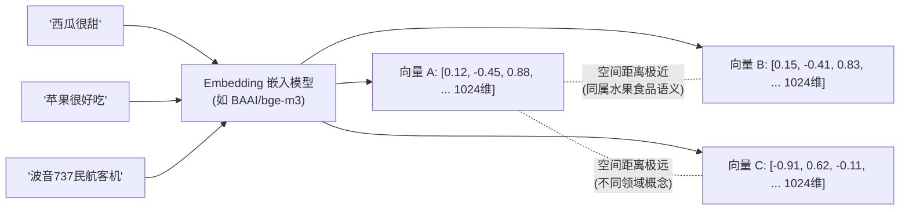
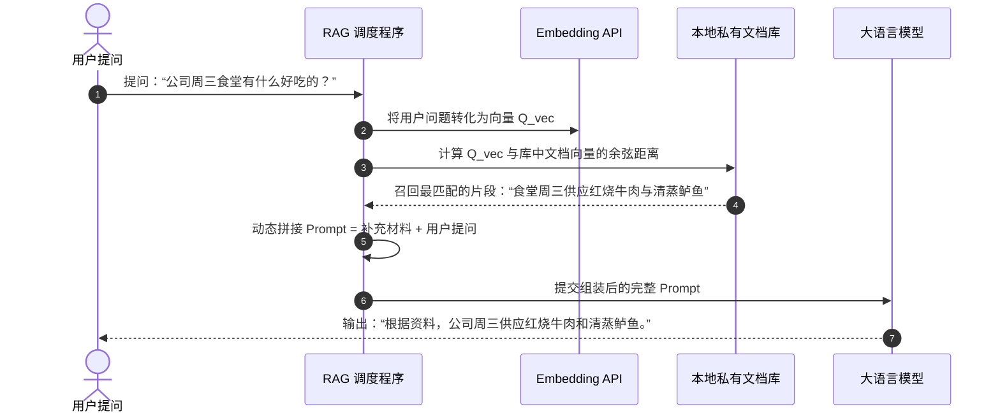
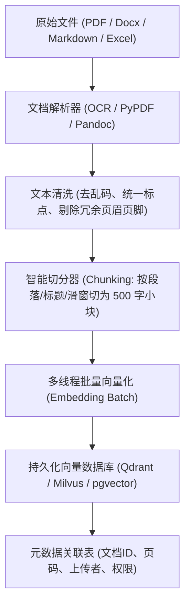

# 第二周：数据底座与个人专属 RAG 极简实现 (教学参考书)

> **本周核心心智模型**：
> “大模型没有真正的记忆，它只是一个强大的推理引擎。RAG（检索增强生成）就是给这个推理引擎准备‘开卷考试的资料库’。本周我们将从最底层的数学向量开始，亲手手写一套原生 RAG，并部署工业级开源知识库系统。”

---

## 目录
- [Day 6: 亲眼见证 Embedding：文本是如何变成数字向量的](#day-6-亲眼见证-embedding文本是如何变成数字向量的)
- [Day 7: 纯数学余弦相似度计算与空间检索](#day-7-纯数学余弦相似度计算与空间检索)
- [Day 8: 30 行原生 Python 组装完整 RAG 链路](#day-8-30-行原生-python-组装完整-rag-链路)
- [Day 9: 工业级开源知识库 Dify / FastGPT 架构与部署](#day-9-工业级开源知识库-dify--fastgpt-架构与部署)
- [Day 10: 第二周工程复盘：RAG 为什么会失败？](#day-10-第二周工程复盘rag-为什么会失败)

---

## Day 6: 亲眼见证 Embedding：文本是如何变成数字向量的

### 1. 核心理念（为什么学，怎么看透）
计算机完全看不懂汉字或英文，它唯一能理解的就是数字。
传统数据库通过 `LIKE '%苹果%'` 检索，如果用户输入“乔布斯创立的手机品牌”，传统数据库瞬间抓瞎，因为字面上没有一个字重叠。
**Embedding（向量嵌入）做的事情，就是把人类语言压缩进一个高维数学空间里。在这个空间里，字面完全不同的词，只要意思相似，它们在坐标系里的物理距离就极度靠近！**

---

### 2. 深度原理解析



#### (1) 什么是 Embedding 向量？
- 假设在二维坐标系中：X 轴代表“水果程度”，Y 轴代表“科技数码程度”。
  - “香蕉”的坐标可能是 `(0.9, 0.1)`；
  - “苹果手机”的坐标可能是 `(0.3, 0.8)`；
  - “橘子”的坐标可能是 `(0.85, 0.05)`。
  - 在几何上，“香蕉”和“橘子”的坐标距离非常近。
- 真实的 Embedding 模型，不是 2 个维度，而是 **1024 维乃至 4096 维**！每一个维度都代表了人类语言中某种极其微妙抽象的特征（语法、情绪、类别、时态等）。

#### (2) 区分两类完全不同的 AI 模型
- **生成大模型 (LLM)**：例如 Qwen-7B、DeepSeek-V3、GPT-4。输入文字，输出文字，负责回答和思考。
- **嵌入模型 (Embedding Model)**：例如 `bge-m3`、`text-embedding-3-small`。输入文字，输出固定长度的浮点数列表（如 `[0.12, -0.45, ...]`），不具备聊天能力，只负责空间坐标测绘。

---

### 3. 极简核心代码与实验

#### 编写实验脚本 `embed_lab.py`
使用任意兼容 API（如 SiliconFlow 或本地 Ollama）来获取向量：
```python
import os
from openai import OpenAI

# 既可调用云端接口，也可指向本地 Ollama: base_url="http://localhost:11434/v1"
client = OpenAI(
    api_key=os.getenv("LLM_API_KEY", "sk-your-api-key"),
    base_url=os.getenv("LLM_BASE_URL", "https://api.siliconflow.cn/v1")
)

corpus = [
    "西瓜非常甘甜爽口",
    "红富士苹果汁水饱满很好吃",
    "波音737是经典的双发涡扇喷气式民航客机"
]

print("正在计算文本嵌入向量...")
response = client.embeddings.create(
    model="BAAI/bge-m3",  # 目前开源界最顶级的多语言 Embedding 模型之一
    input=corpus
)

for idx, item in enumerate(response.data):
    vec = item.embedding
    print(f"\n文本 [{idx}]: \"{corpus[idx]}\"")
    print(f"  -> 向量总维度: {len(vec)}")
    print(f"  -> 前 5 个坐标特征值: {vec[:5]}")
```

运行后观察：每句话都被精准投射成了一个包含 1024 个连续浮点数的空间坐标。

---

### 4. AI 助学提问 Prompt 范式
> “我刚才看到了 Embedding 返回的一个包含 1024 个浮点数的数组。请用通俗的物理空间比喻告诉我：为什么两个句子的向量长度（维度）必须完全一致？如果句子很长，和句子很短，转换出的向量长度会改变吗？”

---

### 5. 常见踩坑与排错指南
1. **报错 `model not found`**：
   - **原因**：误把对话模型的名字（如 `qwen-7b`）当成了 Embedding 模型传给了 `client.embeddings.create`。
   - **解法**：在 Ollama 中需显式执行 `ollama pull bge-m3`，才能提供嵌入服务。

---

### 6. 验收小试炼
- [ ] 亲眼看到并打印出任意一段中文的真实浮点数向量；
- [ ] 能解释清楚：为什么一句话转出来的向量维度是固定不变的。

---

## Day 7: 纯数学余弦相似度计算与空间检索

### 1. 核心理念（为什么学，怎么看透）
很多厂商动不动就鼓吹“向量数据库”、“大模型记忆芯片”，把技术包装得神秘莫测。
今天我们要用 **10 行纯 Python 原生数学代码**，直接揭穿向量检索的底裤：**它底层根本没有任何神秘魔法，就是一个初中几何的‘夹角余弦公式’！**

---

### 2. 深度原理解析

$$\text{Cosine Similarity} = \cos(\theta) = \frac{\mathbf{A} \cdot \mathbf{B}}{\|\mathbf{A}\| \|\mathbf{B}\|} = \frac{\sum_{i=1}^{n} A_i B_i}{\sqrt{\sum_{i=1}^{n} A_i^2} \sqrt{\sum_{i=1}^{n} B_i^2}}$$

- **余弦值为 1.0**：两个向量方向完全重合，语义 100% 相同；
- **余弦值为 0.0**：两个向量垂直正交，语义毫不相干；
- **余弦值为 -1.0**：两个向量方向完全相反（反义词）。

---

### 3. 极简核心代码与实验

#### 编写向量相似度打分器 `cosine_lab.py`
```python
import math
import os
from openai import OpenAI

client = OpenAI(
    api_key=os.getenv("LLM_API_KEY", "sk-your-api-key"),
    base_url=os.getenv("LLM_BASE_URL", "https://api.siliconflow.cn/v1")
)

def cosine_similarity(v1: list[float], v2: list[float]) -> float:
    """计算两个高维向量之间的余弦相似度 (值在 -1 到 1 之间)"""
    dot_product = sum(a * b for a, b in zip(v1, v2))
    norm_v1 = math.sqrt(sum(a * a for a in v1))
    norm_v2 = math.sqrt(sum(b * b for b in v2))
    if norm_v1 == 0 or norm_v2 == 0:
        return 0.0
    return dot_product / (norm_v1 * norm_v2)

# 测试样本
sentences = [
    "西瓜非常甘甜爽口",
    "红富士苹果汁水饱满很好吃",
    "波音737是经典的双发涡扇喷气式民航客机"
]

resp = client.embeddings.create(model="BAAI/bge-m3", input=sentences)
vec_watermelon = resp.data[0].embedding
vec_apple = resp.data[1].embedding
vec_airplane = resp.data[2].embedding

sim_fruit = cosine_similarity(vec_watermelon, vec_apple)
sim_cross = cosine_similarity(vec_watermelon, vec_airplane)

print("="*50)
print(f"【西瓜】 与 【苹果】 的语义相似度: {sim_fruit:.4f}")
print(f"【西瓜】 与 【客机】 的语义相似度: {sim_cross:.4f}")
print("="*50)
```

#### 运行结果观察：
- 西瓜与苹果得分通常在 `0.75 ~ 0.85`；
- 西瓜与客机得分通常在 `0.10 ~ 0.25`；
- **结论**：完全没有调用大模型生成器，仅靠几何点积，机器就精准识别出了“西瓜与苹果同属于食品水果”！

---

### 4. AI 助学提问 Prompt 范式
> “我刚手写了余弦相似度计算函数。请问：当向量库里有 1000 万个文档向量时，逐个用 Python 循环算余弦点积会极度缓慢。工业级向量数据库（如 Chroma、Qdrant、Milvus）是如何利用 HNSW 算法和矩阵加速实现毫秒级搜索的？”

---

### 5. 验收小试炼
- [ ] 能够不用任何第三方复杂库，仅凭 Python 基础算术计算两个向量的余弦夹角；
- [ ] 理解向量数据库在技术栈里的定位：它本质就是一个专门用来快速计算距离的索引器。

---

## Day 8: 30 行原生 Python 组装完整 RAG 链路

### 1. 核心理念（为什么学，怎么看透）
RAG (Retrieval-Augmented Generation，检索增强生成) 听起来高大上，其实用大白话解释只有八个字：
**“先查字典，再做回答”**。
大模型像一个智商极高但与世隔绝的天才。你的公司私有制度、最新合同、个人日记，它事先绝对不可能知道。
你如果直接问它，它只能胡编乱造（幻觉）。
**正确的做法：先从你的资料库里搜出相关的 200 字片段，然后把这 200 字贴在提示词里：“请参考以下资料回答：……”。天才看了一眼资料，立刻答对了。这就是 RAG 的全貌！**

---

### 2. 深度原理解析



---

### 3. 极简核心代码与实验

#### 编写全功能单文件 RAG `mini_rag.py`
```python
import math
import os
from openai import OpenAI

client = OpenAI(
    api_key=os.getenv("LLM_API_KEY", "sk-your-api-key"),
    base_url=os.getenv("LLM_BASE_URL", "https://api.siliconflow.cn/v1")
)

# 1. 模拟我们的私有知识库 (外部公开大模型绝对不知道的虚构事实)
PRIVATE_DOCS = [
    "Alpha公司内部Wi-Fi密码为：SecretPass9988，访客请连接Alpha-Guest网络。",
    "员工食堂每周三中午特色窗口提供：私房红烧牛肉与香煎三文鱼排，凭工卡免费领取。",
    "公司规定弹性工作制：每日核心在线时间为10:00至16:00，午休时间为12:00至13:30。",
    "出差差旅报销标准：一线城市每日住宿补贴上限为600元，餐饮补贴为150元。"
]

def cosine_similarity(v1, v2):
    dot = sum(a * b for a, b in zip(v1, v2))
    return dot / (math.sqrt(sum(a*a for a in v1)) * math.sqrt(sum(b*b for b in v2)))

def simple_rag(user_query: str):
    print(f"\n[用户问题]: {user_query}")

    # 步骤 A: 批量向量化 (将文档库与用户问题统统编码)
    all_texts = PRIVATE_DOCS + [user_query]
    emb_resp = client.embeddings.create(model="BAAI/bge-m3", input=all_texts)
    
    doc_vectors = [item.embedding for item in emb_resp.data[:-1]]
    query_vector = emb_resp.data[-1].embedding

    # 步骤 B: 空间检索 Top-1 最相关的参考资料
    scores = [cosine_similarity(query_vector, doc_vec) for doc_vec in doc_vectors]
    best_doc_idx = scores.index(max(scores))
    relevant_doc = PRIVATE_DOCS[best_doc_idx]
    print(f"[检索召回最相关片段 (相似度: {max(scores):.4f})]:\n -> \"{relevant_doc}\"")

    # 步骤 C: 组装增强 Prompt 注入上下文
    augmented_prompt = f"""你是一名严格严谨的企业问答助手。请仅根据下列已知参考资料回答用户问题。如果参考资料中没有提及，请直接回答‘已知资料未提及，我不知道’，严禁胡编乱造。

【已知参考资料】:
{relevant_doc}

【用户问题】:
{user_query}
"""

    # 步骤 D: 交付大模型生成严谨回答
    chat_resp = client.chat.completions.create(
        model="Qwen/Qwen2.5-7B-Instruct",
        messages=[{"role": "user", "content": augmented_prompt}],
        temperature=0.0  # 严谨事实，温度设为 0
    )
    print(f"[AI 最终基于知识库回答]:\n{chat_resp.choices[0].message.content}\n")

if __name__ == "__main__":
    # 测试问题 1：能检索到
    simple_rag("请问公司周三中午食堂吃什么菜？")
    # 测试问题 2：能检索到
    simple_rag("我们的办公室无线网络密码是多少？")
    # 测试问题 3：知识库没有的信息 (观察模型是否会产生幻觉)
    simple_rag("公司年会什么时候召开？在哪家酒店？")
```

#### 运行观察：
- 对前两个问题，模型给出了丝毫不差的精确答复；
- 对第三个问题，模型诚实地表明“已知资料未提及”。
- **你刚刚亲手实现了一个生产级 RAG 的核心灵魂！**

---

### 4. AI 助学提问 Prompt 范式
> “我刚才跑通了 30 行原生 RAG 代码。请分析：如果用户提问特别长（包含大量废话），或者提问用词与文档用词完全没有交集（例如文档写‘WiFi’，用户问‘怎么上网’），向量检索的召回率会如何表现？有什么工程优化手段？”

---

### 5. 验收小试炼
- [ ] 修改 `PRIVATE_DOCS`，塞入你自己写的一段独家秘密日记；
- [ ] 运行脚本提问，成功让大模型基于你的秘密日记回答出正确答案；
- [ ] 观察当温度设置为 0.0 时，回答的高确定性与严谨度。

---

## Day 9: 工业级开源知识库 Dify / FastGPT 架构与部署

### 1. 核心理念（为什么学，怎么看透）
刚才写的 30 行代码虽然说明了本质，但在真实工业落地中，用户扔进来的是 **500 页的合同 PDF、带合并单元格的 Excel 表格、几万字的 Word 文档**。
你不可能手动把它们写在 Python 列表里。
**我们需要站在巨人的肩膀上——学习并部署目前全球最成熟的开源知识库框架（Dify / FastGPT）**。看懂工业级产品是如何解决“文件解析、自动分块、权限隔离与可视化编排”的。

---

### 2. 深度原理解析



#### 工业级知识库相比“玩具 RAG”多做的核心工程：
1. **递归字符切块 (Recursive Character Text Splitting)**：遇到 Markdown 先按一级标题切，再按二级标题切，最后按句号切。同时设置 10% 的 **重叠窗口 (Overlap)**，防止一句话被切成两半导致语义断裂。
2. **多模态与 OCR**：针对扫描件、图片格式的文档，自动接入 PaddleOCR 或云端视觉模型提取文字。
3. **混合检索 (Hybrid Search)**：向量检索负责模糊意图，BM25 关键词检索负责精准人名/工号匹配，两者取并集加权。

---

### 3. 极简核心代码与实验

#### 部署开源知识库明星项目 Dify (基于 Docker Compose)
1. 克隆 Dify 官方仓库并进入 docker 目录：
   ```bash
   git clone --depth 1 https://github.com/langgenius/dify.git
   cd dify/docker
   ```
2. 复制环境配置文件：
   ```bash
   cp .env.example .env
   ```
3. 一键拉起完整集群（包含 Web、API、Worker、PostgreSQL 数据库、Redis 缓存与向量库）：
   ```bash
   docker compose up -d
   ```
4. 稍等 2~3 分钟，打开浏览器访问 `http://localhost`；
5. 设置管理员账号，进入控制台：
   - 点击顶部导航【知识库 (Knowledge)】 -> 【创建知识库】；
   - 上传本地任意一份 Markdown 或 PDF 文档；
   - 观察其界面展示的“切片预览 (Chunk Preview)”——直观感受工业级产品是如何把长文章拆分成一段段带编号的小卡片的；
   - 设置大模型提供商（填入本地 Ollama 或云端 API Key），在右侧直接开始“基于知识库调试对话”。

---

### 4. AI 助学提问 Prompt 范式
> “我刚部署了 Dify 并在它的后台看到了文档切块（Chunking）功能。请向我解释：如果文档块切得太小（比如每块50字），会有什么坏处？如果文档块切得太大（比如每块2000字），又会有什么坏处？最佳实践的切分长度一般是多少字？”

---

### 5. 验收小试炼
- [ ] 成功在本地拉起 Dify 完整服务；
- [ ] 上传一份个人简历或技术文档，测试让 AI 总结文档中的 3 个核心技能；
- [ ] 在回答下方点击“查看引用源 (Citation)”，直观观察它是召回了哪一个 Chunk 片段。

---

## Day 10: 第二周工程复盘：RAG 为什么会失败？

### 1. 核心理念（为什么学，怎么看透）
市面上很多“AI 割韭菜培训”会告诉你：“只要建个知识库，AI 就能帮你全自动做客服、读财务报表、审查法务合同”。
**作为懂底层的程序员，你必须对这种鬼话嗤之以鼻！**
现实中，朴素 RAG 的失败率高达 40% 以上。今天我们要穿透 RAG 的三大死穴，并掌握工业级的终极武器——**重排模型 (Reranker)**。

---

### 2. 深度原理解析：RAG 三大经典翻车现场

#### (1) 死穴一：切分截断导致因果颠倒
- 原文内容：“……鉴于上述严重的违约行为，**公司决定不予支付任何赔偿金**。”
- 翻车现象：切分器恰好把“违约行为”切在 Chunk 1 的末尾，把“不予支付赔偿金”切在 Chunk 2 的开头。当检索时，Chunk 1 被召回，模型只看到了违约行为，却丢失了结论，直接瞎猜。

#### (2) 死穴二：表格与层级排版的“降维打击”
- 原始文档是复杂的二维表格（包含跨行、跨列、合并单元格）。
- 文本解析器强行把表格拍平成一串单行文字，列与行之间的空间对应关系瞬间崩塌。提问“张三在2024年Q3的差旅费是多少”，模型 100% 串行报错！

#### (3) 救星登场：双塔 Embedding vs 交叉注意力 Reranker
- **Embedding 检索（双塔模型）**：文档向量是事先算好的，问题向量是后来算好的，两者只在最后算一次简单的几何内积。速度极快（毫秒级），但**缺乏对词与词之间交叉关联的深层理解**。
- **Reranker 重排模型（交叉编码器，Cross-Encoder）**：把“问题”和“召回的候选文档”拼成一段长文本，一起塞进神经网络的注意力层计算，深度判断两者是否存在真正的逻辑支撑关系。
- **现代黄金架构**：
  $$\text{10万篇文档} \xrightarrow[\text{Embedding 快速粗排}]{\text{向量库召回 Top-30}} \xrightarrow[\text{Reranker 深度精排}]{\text{重排模型打分}} \text{最终最准的 Top-3 喂给 LLM}$$

---

### 3. 第二周全景回顾与里程碑核销

```
[第 2 周里程碑自检卡]
├── [x] K6: 彻底搞懂 Embedding 语义向量本质，看透多维坐标几何映射
├── [x] K7: 仅凭 10 行原生 Python 实现余弦相似度空间距离计算
├── [x] K8: 独立跑通 30 行单文件微型 RAG 全链路，消灭对知识库的玄学崇拜
├── [x] K9: 掌握 Dify 工业级开源知识库的 Docker 编排架构与切块机制
└── [x] K10: 深刻理解 RAG 翻车痛点，吃透“Embedding粗排 + Reranker精排”黄金流水线
```
到这里，你已经掌握了让 AI 具备私有数据资产检索能力的最强武器。
下一周，我们将跨越纯文本问答，让大模型“长出手和脚”，进入最让人兴奋的领域——**Agent 智能体与通用工具调用协议 (MCP)**！
