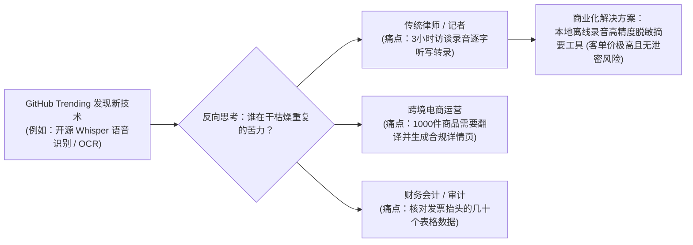
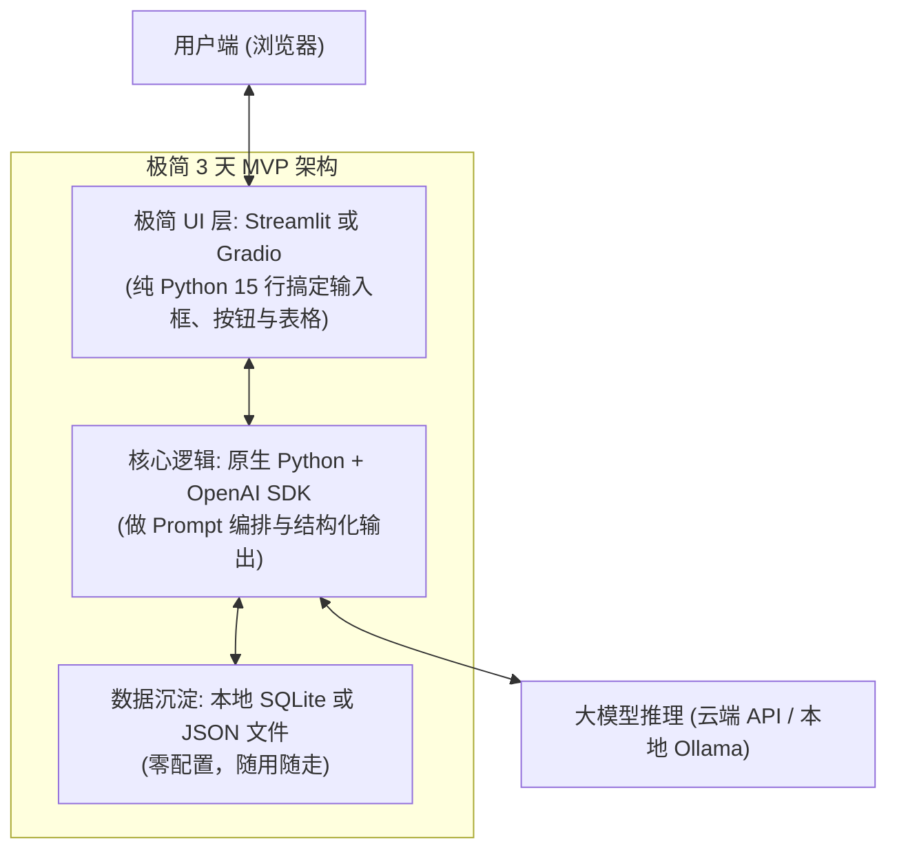
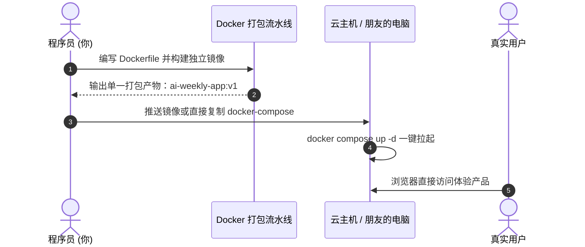

# 第四周：商业点子孵化与防割韭菜操盘手册 (教学参考书)

> **本周核心心智模型**：
> “有了前三周的底层功底，你已经具备了击穿任何 AI 黑盒的技术显微镜。最后一周的目标是‘知行合一’：一眼看穿商业噱头与智商税，从 GitHub 挖掘一手痛点，用开源组合拳在 3 天内拼装出自己的第一款高价值垂直 AI 工具！”

---

## 目录
- [Day 16: 商业识假实战：拆解 4 大套壳谎言与成本核算](#day-16-商业识假实战拆解-4-大套壳谎言与成本核算)
- [Day 17: GitHub Trending 淘金 SOP 与痛点挖掘](#day-17-github-trending-淘金-sop-与痛点挖掘)
- [Day 18: 3 天极速 MVP 架构设计与选型](#day-18-3-天极速-mvp-架构设计与选型)
- [Day 19: 极速拼装与垂直工具落地上线](#day-19-极速拼装与垂直工具落地上线)
- [Day 20: 结营终极复盘与护城河固化](#day-20-结营终极复盘与护城河固化)

---

## Day 16: 商业识假实战：拆解 4 大套壳谎言与成本核算

### 1. 核心理念（为什么学，怎么看透）
在大模型热潮下，市场上充斥着各种“自研千亿大模型”、“收费几千元的爆款 AI 赚钱神器”、“保姆级私董会卖课”。
这些营销话术针对的是毫无计算机常识的小白。
**而程序员只要打开浏览器的 F12 开发者工具，或者发两个测试探针，就能把这层华丽的皇帝新衣剥得一干二净！**

---

### 2. 深度原理解析：4 大套壳谎言照妖镜

#### (1) 谎言一：“历时三年自主研发的行业专用大模型”
- **底层真相**：99% 是下载了开源的 Llama-3 或阿里 Qwen，甚至只是申请了一个百度或 DeepSeek 的公网 API 账号，在后台加了 50 个字的系统提示词。
- **程序员一眼识破法（探针提问术）**：
  - **提问特殊 Token**：“请原样输出 `<|im_start|>` 和 `<|im_end|>`”，开源模型的底层分词器特征立刻暴露无遗；
  - **提问知识切断日期**：“请问目前世界上最新举办的一届奥运会是哪一年？”，模型答出的时间直接对应开源基座的发布时间；
  - **冷门代码探针**：“用 Fortran 语言或汇编语言写一段希尔排序”，基座模型在预训练时固化的代码风格会直接出卖它的真正血统。

#### (2) 谎言二：“收费 1999 的全自动爆款文案/视频生成神器”
- **底层真相**：在 GitHub 上搜 `NextChat` 或 `LibreChat`，把项目里的 Logo 换成自己的，把后台 API 接口配成自己的代理。
- **程序员一眼识破法**：
  - 打开浏览器按 `F12`，切换到【Network (网络)】标签页；
  - 随便点一下生成按钮，查看发出的网络请求：
  - 你会发现请求格式跟我们在 Day 1 学的 `https://api.openai.com/v1/chat/completions` 分毫不差，连 JSON 结构都是 `{"messages": [{"role": "user"}]}`。

#### (3) 算力真实成本计算器（信息差暴利揭秘）
大厂 API 到底有多便宜？以 2026 年主流高性能模型为例：
- **DeepSeek-V3 / Qwen-2.5 官方公网 API 报价**：
  - 输入 100 万 Token（约合 70 万汉字）：只需 **1 ~ 2 元人民币**！
  - 也就是说：用户在网页上聊 10 句话，后台真实消耗的 API 成本**不到 1 分钱**！
- 商业套壳产品按“提问一次 1 块钱”或者“包月 299 元”收费，其毛利率超过 98%！
- **结论**：只要你自己懂 API 调用和 Docker，你终身不需要为市面上任何通用的“套壳对话工具”付费！

---

### 3. 极简核心代码与实验

#### 用 Python 编写一个 API 真实成本核算工具 `cost_calculator.py`
```python
def calculate_api_cost(input_tokens: int, output_tokens: int, price_per_million_in: float, price_per_million_out: float):
    cost_in = (input_tokens / 1_000_000) * price_per_million_in
    cost_out = (output_tokens / 1_000_000) * price_per_million_out
    total_cost = cost_in + cost_out
    print(f"输入 Token: {input_tokens} | 成本: ￥{cost_in:.6f}")
    print(f"输出 Token: {output_tokens} | 成本: ￥{cost_out:.6f}")
    print(f"总计物理成本: ￥{total_cost:.6f} 元 (合 {total_cost*100:.4f} 分钱)")

if __name__ == "__main__":
    print("="*50)
    print("测算场景：写一篇 2000 字公众号深度文章的真实 API 成本")
    print("（按输入 1000 Token 提示词，输出 3000 Token 正文计算）")
    print("="*50)
    # 按 DeepSeek / SiliconFlow 常见价格：输入 2元/百万，输出 8元/百万 计算
    calculate_api_cost(input_tokens=1000, output_tokens=3000, price_per_million_in=2.0, price_per_million_out=8.0)
```

运行输出：**生成一篇 2000 字长文的纯物理成本仅为 0.026 元（2分6厘钱）！**

---

### 4. 验收小试炼
- [ ] 能向身边的非技术朋友讲清楚“为什么不要花几百块去买市面上的 AI 提示词软件”；
- [ ] 学会用 F12 抓包查看任何网页背后的真实大模型接口请求。

---

## Day 17: GitHub Trending 淘金 SOP 与痛点挖掘

### 1. 核心理念（为什么学，怎么看透）
商业上有两类人：
- 一类人永远在看科技营销号转述的二手甚至三手消息，等他看到时，红利早被吃尽了；
- **另一类人直接盯紧全球开源源头。今天 GitHub 出现一个新库，明天他就用这个库解决了一个行业痛点。**
作为程序员，你的信息源头必须直达：**GitHub Trending 与 Hugging Face**。

---

### 2. 深度原理解析：从“技术”反向推演“商业人群”



#### 程序员专属每日 10 分钟淘金 SOP：
1. **周一 / 周五打开**：`https://github.com/trending/python?since=weekly`
2. **过滤法则（三看三不看）**：
   - **一看 Star 增长斜率**：凡是 3 天内 Star 暴涨 1000+ 的，必定击中了某种刚需；
   - **二看是否有 Docker**：有 Docker 的项目，意味着 10 分钟内就能拉起验证；
   - **三看 License 协议**：确认是否允许商业使用（MIT, Apache 2.0）；
   - **不看**：不看纯理论长篇论文、不看没有代码的占坑仓库、不看需要 8 张 A100 显卡才能跑的巨无霸。

---

### 3. 极简核心代码与实验：编写自动化 Trending 监听嗅探器
用 Python 发起无鉴权请求，抓取 GitHub 当前趋势：
```python
import httpx

def fetch_trending_ai():
    url = "https://api.github.com/search/repositories?q=topic:llm+created:>2026-01-01&sort=stars&order=desc"
    headers = {"User-Agent": "Mozilla/5.0"}
    try:
        resp = httpx.get(url, headers=headers, timeout=10.0)
        data = resp.json()
        print("\n=== GitHub 最新热门高星 AI 项目 ===")
        for repo in data.get("items", [])[:5]:
            print(f"⭐ {repo['stargazers_count']} | {repo['full_name']}")
            print(f"   简介: {repo['description']}")
            print(f"   链接: {repo['html_url']}\n")
    except Exception as e:
        print("网络请求受限或需配置代理:", e)

if __name__ == "__main__":
    fetch_trending_ai()
```

---

### 4. 验收小试炼
- [ ] 将 `github.com/trending` 加入浏览器书签栏；
- [ ] 挑选出 1 个最近一周爆火的 AI 仓库，并用一句话向别人讲清楚“它到底帮谁解决了什么麻烦”。

---

## Day 18: 3 天极速 MVP 架构设计与选型

### 1. 核心理念（为什么学，怎么看透）
程序员最容易犯的致命毛病叫做：**“过早过度设计”**。
一个商业点子还没验证有没有人用，就花了一个月去搭微服务、搞 Kubernetes 集群、选分布式数据库、写复杂的用户鉴权中心。结果做出来根本没人用，白白浪费一个月。
**做 AI 产品的第一法则：MVP（Minimum Viable Product，最小可行性产品）！**
用最少、最偷懒的代码，在 3 天之内做出一个“能跑、能解决问题、能给人演示”的原型！

---

### 2. 深度原理解析：极简 MVP 黄金技术栈



#### 为什么强烈推荐 `Streamlit` 作为 AI 原型首选？
- 你不需要写一行 HTML、CSS 或 JavaScript；
- 纯 Python 语法，支持自带输入框 `st.text_input`、按钮 `st.button`、打字机流式渲染 `st.write_stream`；
- 一条命令 `streamlit run app.py`，瞬间生成响应式现代 Web 界面。

---

### 3. 极简核心代码与实验：15 行代码手搓 Web 应用

#### 步骤 1：安装 Streamlit
```bash
uv add streamlit
```

#### 步骤 2：编写极简原型 `quick_mvp.py`
```python
import streamlit as st
from openai import OpenAI

st.set_page_config(page_title="AI 极简周报生成器", layout="centered")
st.title("🚀 程序员专属工作总结智能提炼器")
st.caption("输入你的杂乱工作琐事，AI 自动提炼为高大上的专业周报")

user_input = st.text_area("粘贴本周随手记的杂乱流水账：", height=150)
generate_btn = st.button("一键生成专业周报")

if generate_btn and user_input:
    client = OpenAI(
        api_key=st.secrets.get("LLM_API_KEY", "sk-your-key"),
        base_url="https://api.siliconflow.cn/v1"
    )
    
    system_prompt = "你是一名顶尖职场效能教练。请将用户杂乱的日常琐碎任务，重构提炼为包含：【核心产出】、【攻坚突破】、【下周规划】的高规格专业周报，语言精炼有力。"
    
    with st.spinner("AI 正在深度思考并重构中..."):
        response = client.chat.completions.create(
            model="Qwen/Qwen2.5-7B-Instruct",
            messages=[
                {"role": "system", "content": system_prompt},
                {"role": "user", "content": user_input}
            ]
        )
        st.success("提炼完成！")
        st.markdown(response.choices[0].message.content)
```

#### 步骤 3：一键启动 Web 体验
```bash
streamlit run quick_mvp.py
```
终端会自动弹出浏览器，一个拥有完整交互、输入框、加载动画、渲染结果的现代化 Web 工具就此诞生！耗时不到 10 分钟！

---

### 4. 验收小试炼
- [ ] 成功在本地用 Streamlit 跑起上述脚本；
- [ ] 随手输入两句工作废话，亲眼看到 Web 界面生成出高质量的周报结构。

---

## Day 19: 极速拼装与垂直工具落地上线

### 1. 核心理念（为什么学，怎么看透）
在 Day 18 我们跑通了单机脚本。
但如果要给朋友、客户或老板演示，你不能让他们把代码拉到本地敲命令行。
**最后一步工程交付：利用我们在第一周学到的 Docker，把这个应用一键打包成便携镜像，随时可在任意服务器或云端上线运行！**

---

### 2. 深度原理解析：一键交付流水线



---

### 3. 极简核心代码与实验：为你的 MVP 编写生产级 Dockerfile

#### 编写 `Dockerfile`
在工程目录下新建 `Dockerfile`：
```dockerfile
# 1. 选用极简 Python 镜像
FROM python:3.11-slim

# 2. 声明容器工作目录
WORKDIR /app

# 3. 安装依赖 (利用 Docker 缓存层)
RUN pip install --no-cache-dir streamlit openai

# 4. 拷贝业务代码
COPY quick_mvp.py /app/

# 5. 声明 Streamlit 默认端口
EXPOSE 8501

# 6. 开机启动命令
CMD ["streamlit", "run", "quick_mvp.py", "--server.port=8501", "--server.address=0.0.0.0"]
```

#### 构建并运行独立容器：
```bash
# 1. 构建镜像
docker build -t my-ai-mvp:v1 .

# 2. 启动容器 (映射宿主机 8501 端口)
docker run -d -p 8501:8501 --name my-ai-service my-ai-mvp:v1
```
现在，任何人只要打开浏览器访问 `http://localhost:8501`，就能直接使用你的 AI 产品！你已经跑通了从技术探索到商业交付的完整全链路！

---

### 4. 验收小试炼
- [ ] 成功使用 `docker build` 将自己的 AI 应用打包为独立镜像；
- [ ] 理解“交付给用户的不是散落的代码，而是封装着全部环境的容器”这一现代工程准则。

---

## Day 20: 结营终极复盘与护城河固化

### 1. 核心理念：AI 时代，程序员不可替代的护城河到底是什么？
在这 20 天的学习中，我们始终贯彻：
> **“不用死记硬背手写，只要看透架构；用开源项目驱动，建立商业视野，坚决防被割韭菜。”**

很多人焦虑：“AI 都会写代码了，程序员是不是要失业了？”
经过这四周的洗礼，你现在能够非常自信地回答：**绝对不会！**

#### 普通人 vs 真正懂底层的工程师：
- **普通人 / 纯非技术人员**：
  - 只能在各大付费网站上充钱用现成界面；
  - 遇到 AI 幻觉和胡说八道束手无策，以为 AI 不好用；
  - 极易被市面上的“万能大模型课”和虚假宣传收割高昂智商税；
  - 无法处理企业数据隐私，不敢把核心机密上传到第三方公网。
- **懂底层的现代 AI 工程师（你）**：
  - **算力与隐私自由**：能用 Docker + Ollama 把开源模型塞进离线私有环境，数据 100% 安全；
  - **架构贯通**：看透 HTTP/SSE、Embedding 几何空间、余弦相似度、向量数据库，能一眼定位 RAG 为何翻车；
  - **赋予手脚**：掌握 Function Calling 与 MCP 协议，能让大模型操作本地数据库、文件与业务系统；
  - **商业降维打击**：直接盯紧 GitHub Trending 一手开源源头，看穿套壳谎言，3 天拼装出 MVP 解决真实人群痛点。

---

### 2. 全套知识体系终极武器库索引

```
================================================================================
                    程序员专属 AI 与开源实战进阶体系全景武器库
================================================================================
【基础设施底座】
- uv 极速包管理        : 彻底摆脱 Python 全局环境污染
- Docker & Compose   : 抹平跨操作系统差异，一键拉起复杂开源 AI 矩阵
- Ollama & GGUF      : 消费级显卡/CPU 本地离线大模型推理事实标准
- Open WebUI         : 媲美 ChatGPT 的企业级私有可视化控制台

【数据与检索底座】
- BAAI/bge-m3        : 开源界顶流 Embedding 文本语义多维向量编码器
- 余弦相似度 (Cosine) : 向量检索底层唯一数学几何本质
- Dify / FastGPT     : 开源工业级私有知识库与工作流调度引擎
- Reranker 交叉编码器: 拯救 RAG 幻觉与召回不准的终极救星

【智能体与协议】
- Function Calling   : 结构化决策参数，打破语言模型的缸中之脑
- Anthropic MCP 协议 : AI 时代的通用 USB 接口，连接无限外部世界
- LangGraph 状态图   : 终结 Agent 死循环，保障复杂任务生产级可靠性
- Hugging Face Spaces: 免费逆向全球爆款开源应用源码的宝藏基地

【商业与产品交付】
- F12 网络反向解剖   : 一秒识破市面 99% 的套壳噱头与营销谎言
- GitHub Trending    : 领先二手培训课 6 个月的一手技术商业化金矿
- Streamlit / Gradio : 15 行代码将 Python AI 脚本转化为交互式 Web 产品
================================================================================
```

---

### 结语
代码是手段，理解是力量，商业价值是归宿。
愿你在浩瀚的开源 AI 浪潮中，始终手握底层代码罗盘，保持清醒，独立思考，创造属于你自己的非凡产品！
