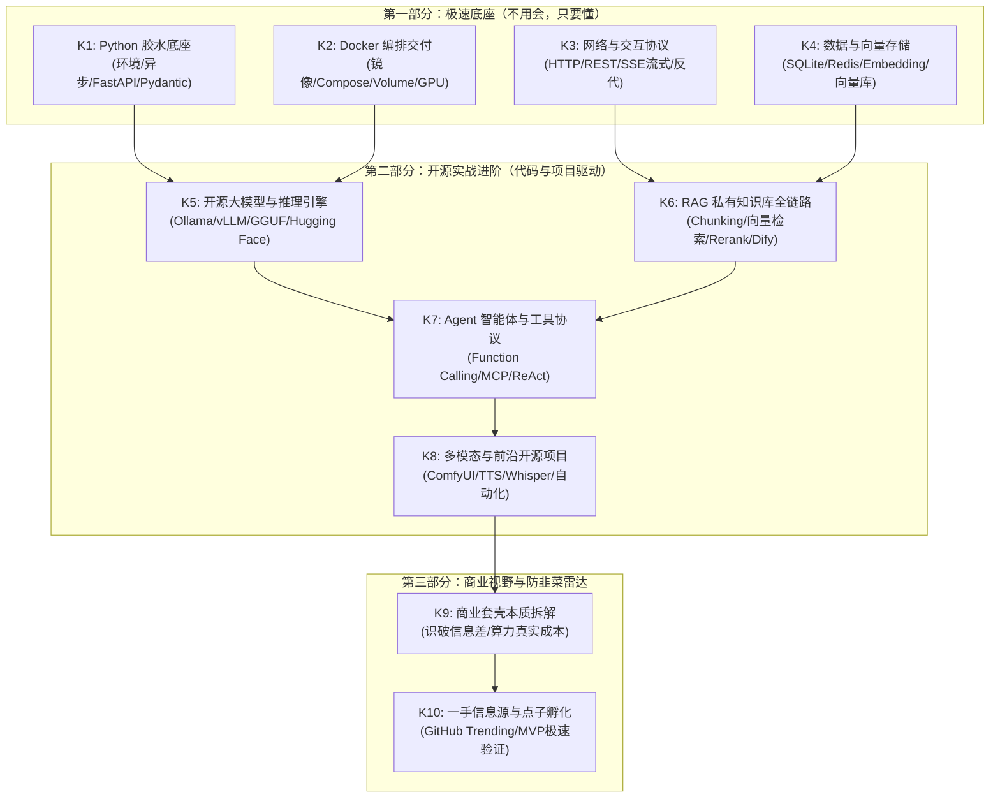
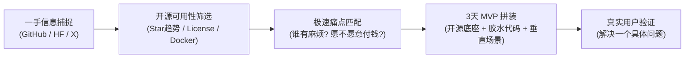

# 程序员专属 AI 与开源实战进阶体系：知识清单 (知识清单.md)

> **设计哲学**：
> “程序员的优势在于能够很底层地使用 AI 甚至自己开发。有很多 AI 应用、模型是以代码模式放在 GitHub、Hugging Face 上的，大厂也会开放 API 给技术人员。
> **用 AI 快速学习编程底座（Python、Docker、网络、数据库）——不用精通手写，只要看懂架构；然后再尝试开源 AI 项目，在实战中持续吸收 AI 知识。建立应用视野与商业点子，坚决防被割韭菜。**”

---

## 知识体系结构概览

---

## 第一部分：极速编程与工程底座（不用会，只要懂）

> **心法原则**：
> 绝不花三个月去背语法、刷 LeetCode！我们学这些的唯一目的，是**当 AI 生成代码或你在 GitHub 看到一个开源项目时，能看懂它的目录、入口、配置、网络调用与依赖**。写代码交给 AI，你负责看懂架构和纠错。

### 模块 K1: Python 极速 AI 胶水底座

| 编号 | 核心知识点 | 为什么要懂（在 AI 时代的角色） | “懂”的及格标准（不用精通） | 典型验证场景 / AI 提示词助学法 | 优先级 |
| :--- | :--- | :--- | :--- | :--- | :---: |
| **K1.1** | **虚拟环境与现代依赖管理** (`uv` / `venv` / `pip`) | AI 开源项目 80% 的报错都死在环境冲突和 Python 版本不兼容上。必须掌握环境隔离。 | 知道为什么不能全局 `pip install`；能看懂 `requirements.txt` 和 `pyproject.toml`；会用一条命令创建独立虚拟环境。 | **场景**：运行 GitHub 项目出现版本报错。 **Prompt**：“我运行开源项目报错 `ModuleNotFoundError` 或版本冲突，请分析这份 `requirements.txt` 并教我用 `uv` 隔离环境运行。” | P0 |
| **K1.2** | **核心数据结构与 JSON** (Dict / List / JSON 序列化) | 大模型所有的输入输出、API Payload、Prompt 模板、配置参数本质上全是 Dict 和 JSON 嵌套。 | 能一眼看懂多层嵌套的字典/列表结构；知道 `json.dumps()` 和 `json.loads()` 是在字符串与对象之间转换。 | **场景**：大模型返回了 JSON 字符串，代码尝试当字典读取导致报错。 **Prompt**：“用生活例子解释 Python 字典与 JSON 字符串的区别，展示如何安全解析大模型输出。” | P0 |
| **K1.3** | **异步编程与生成器流式传输** (`async/await`, `yield`) | 大模型生成内容是一字一字“吐”出来的（流式 Streaming），背后就是 Python 生成器和异步 HTTP。 | 理解为什么流式传输不会卡死主线程；看到 `async def` 和 `yield` 知道这是为了做流式返回或高并发。 | **场景**：看到类似 `for chunk in response: yield chunk` 能秒懂这是打字机流式输出。 **Prompt**：“请用动画般的白话比喻解释：生成器 `yield` 是如何让大模型实现一字一顿打字机效果的？” | P1 |
| **K1.4** | **AI 核心胶水库** (`FastAPI`, `Pydantic`, `httpx`, `openai-python`) | 现代开源 AI 项目通用的后端标准（FastAPI 做接口、Pydantic 做类型校验、官方 SDK 调模型）。 | 看懂一个 20 行的 FastAPI 路由接口，知道怎么通过 Pydantic 约束大模型返回特定的数据格式。 | **场景**：阅读 NextChat 或 Dify 后端 API 接口源码。 **Prompt**：“分析这段 FastAPI 极简代码，说明它是如何接收前端 prompt 并通过 OpenAI SDK 转发给模型的。” | P0 |

---

### 模块 K2: Docker 与现代容器交付（消除“在我的电脑上跑不起来”）

| 编号 | 核心知识点 | 为什么要懂（在 AI 时代的角色） | “懂”的及格标准（不用精通） | 典型验证场景 / AI 提示词助学法 | 优先级 |
| :--- | :--- | :--- | :--- | :--- | :---: |
| **K2.1** | **容器与镜像的本质** (Images vs Containers) | 开源 AI 项目依赖复杂（CUDA、C++ 编译器、Python 库），Docker 是抹平 Windows/Mac/Linux 差异的唯一救星。 | 明白“镜像是打包好的系统模板，容器是真正跑起来的实例”；知道容器删了数据会丢，需要挂载。 | **场景**：从 Docker Hub 拉取一个 Ollama 镜像并启动。 **Prompt**：“用光盘制作与系统启动的比喻，讲透 Docker 镜像和容器的关系。” | P0 |
| **K2.2** | **Dockerfile 核心指令解读** (`FROM`, `RUN`, `COPY`, `CMD`) | 很多顶级 GitHub AI 仓库只给 Dockerfile。看懂它就能看懂这个项目到底装了什么。 | 能看懂 Dockerfile 的构建步骤；知道 `EXPOSE` 是声明端口，`CMD` 是开机启动命令。 | **场景**：拿到没有现成镜像的 GitHub 仓库，看懂其 Dockerfile 自行编译。 **Prompt**：“请逐行拆解这个开源项目的 Dockerfile，解释每条指令的作用及为什么这么排版。” | P1 |
| **K2.3** | **Docker Compose 多服务编排** (`docker-compose.yml`) | 现代 AI 架构往往是“前端 WebUI + 后端 API + 向量数据库 + 缓存”组合，Compose 是一键拉起的标准。 | 能看懂一个 `docker-compose.yml` 文件；知道 `services`、`ports`、`environment`、`volumes` 分别对应什么。 | **场景**：一键运行 OpenWebUI + Ollama 组合。 **Prompt**：“给出一段最简的 docker-compose.yml 示例，同时启动本地模型服务与可视化 Web 界面。” | P0 |
| **K2.4** | **端口映射与数据卷挂载** (Port Forwarding & Volumes) | 解决两大常见踩坑：① 端口冲突访问不了；② 容器重启后模型权重文件丢失又要重新下载 10GB。 | 明白 `-p 8080:80`（宿主机端口:容器端口）的逻辑；明白 `-v ./data:/app/data` 是把宿主机目录挂进容器保全数据。 | **场景**：本地下载了 20GB 的大模型文件，挂载到容器中直接读取。 **Prompt**：“画图解释 Docker 端口映射与 Volume 数据卷挂载的数据流向。” | P0 |
| **K2.5** | **GPU 穿透与 CUDA 容器化** (NVIDIA Container Toolkit) | 想要在 Docker 容器里调用本地英伟达显卡加速推理，必须打通 GPU 穿透。 | 知道 `--gpus all` 的含义，知道本地宿主机装驱动、容器内部装 CUDA 运行时的分工。 | **场景**：在 Docker 中以 GPU 模式启动 vLLM 推理服务。 **Prompt**：“解释 Windows/Linux 下如何让 Docker 容器识别并使用本地 NVIDIA 显卡进行 AI 推理。” | P1 |

---

### 模块 K3: 计算机网络与大模型交互机制（穿透黑盒）

| 编号 | 核心知识点 | 为什么要懂（在 AI 时代的角色） | “懂”的及格标准（不用精通） | 典型验证场景 / AI 提示词助学法 | 优先级 |
| :--- | :--- | :--- | :--- | :--- | :---: |
| **K3.1** | **HTTP/HTTPS 请求与 RESTful 契约** | 所有云端大模型 API（OpenAI, DeepSeek, 智谱等）本质上全是标准的 HTTP POST 请求。 | 理解 URL、Headers（请求头）、Status Code（状态码：200/401/429/500）、Request Body（请求体）。 | **场景**：调用模型 API 报 401（未授权）或 429（限流超频），能一眼看出原因。 **Prompt**：“列出调用大模型 API 最常见的 HTTP 状态码及其排查应对方案。” | P0 |
| **K3.2** | **API-Key 与 Bearer Token 鉴权** | 访问任何大厂大模型的第一道门禁。 | 明白 Authorization 请求头的规范写法（`Bearer sk-...`）；树立“API Key 绝不提交到 GitHub 或暴露到前端”的安全意识。 | **场景**：写脚本调用 SiliconFlow / DeepSeek API。 **Prompt**：“解释为什么前端网页直接写 API Key 极其危险，标准的安全代理架构应该长什么样？” | P0 |
| **K3.3** | **SSE (Server-Sent Events) 与 WebSocket** | 大模型打字机效果的技术底座。理解了 SSE，就理解了 95% AI 对话产品的通信链路。 | 知道 SSE 是基于普通 HTTP 的长连接单向流（服务端持续推 `data: {"text": "..."}`）；能区分 SSE 与双向 WebSocket。 | **场景**：前端页面接收大模型实时流式返回并渲染。 **Prompt**：“对比普通 HTTP Request、SSE 与 WebSocket，说明为什么大模型对话普遍采用 SSE？” | P0 |
| **K3.4** | **跨域 (CORS)、反向代理与本地代理** | 开发者最常遇到的网络墙：本地 Web 页面调用 API 跨域；或者调国外 API 需要配置 HTTP 代理。 | 理解浏览器的跨域拦截机制；会看懂 Nginx/Caddy 的反向代理配置；知道在终端设置 `HTTP_PROXY` / `HTTPS_PROXY`。 | **场景**：本地前端调用后台接口报 CORS 错误；或者 Python 脚本拉取 Hugging Face 权重超时。 **Prompt**：“用最白话的语言讲清什么是 CORS 跨域错误，以及后端/代理层如何优雅解决。” | P0 |

---

### 模块 K4: 数据存储与向量高维检索（从表格到语义空间）

| 编号 | 核心知识点 | 为什么要懂（在 AI 时代的角色） | “懂”的及格标准（不用精通） | 典型验证场景 / AI 提示词助学法 | 优先级 |
| :--- | :--- | :--- | :--- | :--- | :---: |
| **K4.1** | **轻量嵌入式数据库** (`SQLite` / DuckDB) | 许多本地开源 AI 工具、个人知识库、聊天记录保存的首选，单文件无须单独起服务。 | 知道 SQLite 是一个本地 `.db` 文件，零配置；能看懂基础建表、插入与查询 SQL。 | **场景**：检查开源聊天客户端导出的 SQLite 历史对话数据。 **Prompt**：“用 10 行 Python 代码演示如何使用自带的 sqlite3 创建表并读写对话数据。” | P1 |
| **K4.2** | **向量嵌入本质** (What is Embedding?) | RAG 和语义搜索的核心支柱，AI 将人类自然语言转化为机器可计算数学向量的桥梁。 | 明白 Embedding 是把一段话变成由数百到数千个浮点数组成的数组（如 `[0.12, -0.45, ...]`）；**语义越相似，向量在高维空间夹角越小**。 | **场景**：测试“苹果手机”与“iPhone”的向量相似度，观察它们即使字面不重叠但向量高度接近。 **Prompt**：“请用三维立体坐标系做比喻，通俗解释为什么 Embedding 向量能够衡量两句话的语义相似度。” | P0 |
| **K4.3** | **向量数据库与相似度计算** (Chroma / Qdrant / 余弦相似度) | 传统数据库靠关键词精确匹配，向量数据库靠数学距离（余弦、欧式）做模糊语义召回。 | 理解 Top-K 召回（找出距离最近的 K 条记录）；知道 Chroma 是轻量单机首选，Qdrant / Milvus 是工业级首选。 | **场景**：把 100 篇文档存入 Chroma，用一句话提问检索出最相关的 3 篇。 **Prompt**：“对比 MySQL 的 LIKE '%keyword%' 和向量数据库的余弦相似度检索，两者的根本区别与优缺点。” | P0 |
| **K4.4** | **混合检索与元数据过滤** (Hybrid Search & Metadata Filtering) | 纯向量检索经常在“人名、专有名词、时间范围”上翻车，企业级 RAG 必须配合元数据过滤。 | 理解“关键词检索 (BM25) + 语义向量检索 (Embedding)”双路召回；知道在向量库里存入 `category: "财务"` 等标签进行精准过滤。 | **场景**：搜索“2025年张三的差旅报销”，如何结合精确过滤与语义匹配。 **Prompt**：“为什么纯向量数据库经常找不到具体的人名和工号？什么是元数据过滤与混合检索？” | P1 |

---

## 第二部分：开源 AI 实战进阶（代码与项目驱动）

> **心法原则**：
> 从“能跑通别人的”到“能组合多个工具”，再到“能魔改核心逻辑”。通过真实开源项目把前置底座串联起来。

### 模块 K5: 开源大模型与推理引擎（Hugging Face 与 GitHub）

| 编号 | 核心知识点 | 为什么关键 | 掌握与实战标准 | 推荐开源项目 / 实践对象 | 优先级 |
| :--- | :--- | :--- | :--- | :--- | :---: |
| **K5.1** | **模型参数规模与显存算力法则** | 不做无脑尝试，精准预估自己电脑能不能跑。 | 牢记显存估算公式：FP16 模型显存 ≈ 参数量 × 2GB；4-bit 量化模型显存 ≈ 参数量 × 0.75GB。7B 模型 4-bit 需约 6GB 显存。 | 掌握 Qwen2.5-7B, DeepSeek-R1-Distill-7B, Llama-3 的配置需求。 | P0 |
| **K5.2** | **模型量化格式与生态** (`GGUF` / `AWQ`) | 让大模型在消费级显卡乃至纯 CPU 上流畅运行的关键技术。 | 知道 `GGUF` 是 llama.cpp 生态的通用量化文件；知道 `Q4_K_M`、`Q8_0` 是什么意思；知道在 Hugging Face 找量化权重。 | Hugging Face 搜索 TheBloke / bartowski 的 GGUF 仓库。 | P0 |
| **K5.3** | **本地极速推理运行时** (`Ollama` / `vLLM` / `llama.cpp`) | 本地部署大模型的三剑客，提供开箱即用的 OpenAI 兼容 API。 | 会用 Ollama 一键拉取运行模型；知道通过 `http://localhost:11434/v1` 像调用 OpenAI 一样调用本地模型。 | **实战**：`ollama run qwen2.5:7b`；启动 OpenWebUI 对接 Ollama。 | P0 |
| **K5.4** | **Hugging Face 生态全景** (Hub / Spaces / Diffusers) | AI 领域的 GitHub，全球所有开源模型与数据集的大本营。 | 熟练使用网页端过滤下载模型；使用 `huggingface_hub` CLI 工具断点续传大文件；利用 Spaces 体验云端 Demo。 | `huggingface-cli download` 实践；浏览 HF Trending 榜单。 | P0 |

---

### 模块 K6: RAG 私有知识库全链路（打破上下文限制）

| 编号 | 核心知识点 | 为什么关键 | 掌握与实战标准 | 推荐开源项目 / 实践对象 | 优先级 |
| :--- | :--- | :--- | :--- | :--- | :---: |
| **K6.1** | **文档切分与清洗** (Chunking Strategies) | RAG 效果差 80% 是切分做烂了（上下文被一刀切断）。 | 理解固定字符切分（Chunk Size + Overlap）、Markdown 语法树切分；知道重叠窗口 (Overlap) 是为了保留上下文连贯。 | 用 Python 手写一段基于段落和标题的简单切分逻辑。 | P0 |
| **K6.2** | **端到端 RAG 极简实现** | 脱离重型框架，亲手看懂底层全链路。 | 用 40 行 Python 代码串联：`加载文本 -> 切块 -> 调 API 向量化 -> 存入内存 -> 计算距离 -> 拼装 Prompt -> 喂给模型生成`。 | 手写无依赖单文件 RAG 脚本。 | P0 |
| **K6.3** | **重排机制 (Reranker) 与检索后处理** | 粗排向量库召回 Top-20，精排 Rerank 筛选出最准的 Top-3，大幅降低幻觉。 | 明白 Embedding 只能算浅层相似度，Cross-Encoder Reranker（如 BAAI/bge-reranker）才能真正判断问题与文档的相关度。 | 体验带 Rerank 与不带 Rerank 的召回质量差异。 | P1 |
| **K6.4** | **开源成熟知识库平台拆解** (`Dify` / `FastGPT` / `RAGFlow`) | 站在巨人肩膀上，理解工业级 RAG 产品的全功能设计。 | 用 Docker Compose 本地部署 Dify 或 FastGPT；配置一个私有文档问答助手，拆解其后台工作流。 | GitHub: `langgenius/dify`, `labring/FastGPT`。 | P0 |

---

### 模块 K7: Agent 智能体、工具协议与工作流（赋予 AI 手脚）

| 编号 | 核心知识点 | 为什么关键 | 掌握与实战标准 | 推荐开源项目 / 实践对象 | 优先级 |
| :--- | :--- | :--- | :--- | :--- | :---: |
| **K7.1** | **Function Calling 与 ReAct 循环** | 从纯文本聊天跨越到能执行任务的根本质变。 | 明白大模型**自己不会执行代码**，它做的是“根据提示输出一段符合 JSON Schema 规范的函数名和参数”，由你的程序执行后将结果塞回给模型。 | 用 OpenAI SDK 手写一个天气查询/计算器函数调用。 | P0 |
| **K7.2** | **MCP (Model Context Protocol) 标准协议** | Anthropic 提出的划时代通用工具协议，正在成为 AI 工具调用的行业标准。 | 理解 MCP 的 Client-Host-Server 三层架构；明白为什么 MCP 能让一个工具在 Claude Desktop、Cursor、Antigravity 之间无缝复用。 | 运行一个现成开源 MCP Server（如 SQLite、文件系统、GitHub）。 | P0 |
| **K7.3** | **多 Agent 协作与状态编排** (`LangGraph` / `CrewAI`) | 单 Agent 容易陷入长上下文遗忘和死循环，多角色拆解是解决复杂工程任务的唯一出路。 | 了解基于状态图（State Graph）的工作流设计；理解“研究员、编码员、代码审查员”如何分工交接。 | 阅读 LangGraph 或 CrewAI 的基础官方入门 Demo。 | P1 |

---

## 第三部分：商业视野、点子孵化与防割韭菜反脆弱指南

> **心法原则**：
> 具备了底层代码与开源能力后，你已经超越了 95% 的普通用户。但要把技术转化为价值，必须看懂商业套壳逻辑，建立一手信息雷达，避开智商税陷阱。

### 模块 K8: 商业套壳与虚假宣传拆解手册（防割韭菜）

| 韭菜套路标签 | 市场包装话术 | 底层真实技术真相 | 程序员视角的一眼识破法 |
| :--- | :--- | :--- | :--- |
| **套路 1：自研百亿国产大模型** | “我们团队历时三年自研了具有自主知识产权的行业垂直千亿大模型……” | 99% 是下载了 Llama-3 或 Qwen 开源基座模型，改了系统提示词或者做了极小量 LoRA 微调，甚至只是套壳 API 转发。 | 看推理接口输出格式、看特殊 Token（如 `<|im_start|>`）、让它写敏感冷门代码暴露底层原生权重特征。 |
| **套路 2：万能一键生成赚钱神器** | “收费 2999 元的 AI 全自动爆款写作/文生图神器，小白躺赚！” | 本质上是一个用 NextChat / LibreChat 改了 Logo 的开源前端，后台挂了一个廉价 API Key，或者加了几段公开的 Prompt 模板。 | 检查网页源码和网络请求 Payload，一秒看出调用的是哪家公网接口。 |
| **套路 3：本地知识库万能解密** | “彻底替代员工！把公司 10 万份文档扔进去，AI 自动回答一切业务问题。” | 简单的朴素 RAG。面对没有排版的表格、扫描件 PDF、复杂层级报表必然大面积幻觉甚至胡说八道。 | 拿一张合并单元格的复杂财务报表或带有否定句的合同直接提问，立刻打出幻觉原型。 |
| **套路 4：AI 私董会与卖课社群** | “抓住时代风口，教你不会编程如何用 AI 变现，月入十万。” | 贩卖焦虑。课程内容全是一手文档翻译、GitHub 开源项目文档的删减版、过时的 Midjourney/ChatGPT 提示词。 | 直接看 GitHub Trending 和官方文档，一手信息完全免费且领先课程至少半年。 |

---

### 模块 K9: 一手信息源与商业点子孵化 SOP

#### 1. 程序员专属四大免费一手信息源
1. **GitHub Trending** (`github.com/trending`)：
   - 关注 Python、TypeScript 分类，每周一、周五扫一次。凡是 3 天破千 Star 的 AI 库，必有新玩法或新需求爆发。
2. **Hugging Face Daily Papers & Trending** (`huggingface.co/papers`)：
   - 追踪模型权重发布、全新架构和前沿 Demo。
3. **X (Twitter) 顶级开源核心圈**：
   - 关注各大开源框架作者（Andrej Karpathy、Logan Kilpatrick、各开源项目 Maintainer），新模型发布第一分钟看评测。
4. **大厂一手技术博客与 API 文档**：
   - OpenAI Cookbook, Anthropic Engineering Blog, DeepSeek 官方文档。任何第三方二道贩子教程的质量都低于一手文档。

#### 2. 点子孵化三大高价值垂直方向（别做大而全，做深而窄）
- **方向 A：冷门垂直行业的“结构化数据提取与清洗”**
  - 不做泛化知识库，专攻特定格式（如海关报关单、医疗检验单、工程招投标文件），结合开源 OCR + LLM 输出高保真结构化 JSON。
- **方向 B：本地私有化数据安全助手（面向律师、财务、程序员）**
  - 利用 Ollama + 本地轻量模型，在绝对断网环境下提供本地代码安全审查或合规排查，击中用户“不敢上传云端”的刚需。
- **方向 C：自动化工作流与跨软件粘合剂**
  - 利用 MCP 协议或 n8n，把日常枯燥的 5 步操作（收邮件 -> 提取附件 -> 总结重点 -> 写入表格 -> 发飞书通知）串联成闭环。
