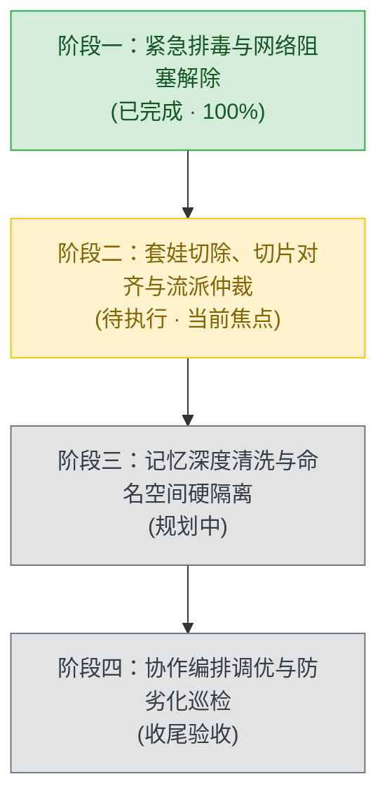

# GOVERNANCE OPTIMIZATION ROADMAP (体系解毒与工程治理总体路线图)

> **治理宗旨**：彻底切除规则官僚化、技能套娃重复、理念互斥撕裂与记忆跨项目穿透四大毒点，打造既有生产级防线、又有极致敏捷流畅度（Vibe Coding）的现代化 AI 工程底座。

---

## 总体四阶段里程碑全景

---

## 阶段详细任务拆解

### 🟢 阶段一：紧急排毒与阻塞解除 (Quick Wins & Unblock)
- **核心目标**：解除最显眼的 16 秒网络延迟硬阻断，消除暴露在外层的显性重复插件。
- **状态**：✅ **已 100% 验收落地** (2026-10-11)
- **交付清单**：
  1. [x] **物理清理全局重复技能**：移除了 `config/skills` 下被 Plugins 托管的 8 个插件副本（`ponytail*` 6个、`shuorenhua`、`karpathy-guidelines`）。
  2. [x] **工作区代码纯净度**：将无关的学科考试技能 `.agents/skills/good-learning` 迁出当前代码库。
  3. [x] **主规则松绑 (`AGENTS.md`)**：
     - 强制 Recall Hooks 降级为按需自主召回，消除写单测/排版前的 16 秒网络等待；
     - 废除机械的 60~100 行单次读取限制，改为语义块优先（≤300行）；
     - 放宽三红线文件数门槛至 3 个以上，常规多文件联动豁免停机。
  4. [x] **全局记忆隔离公约**：向 Second Brain 写入项目级隔离公约（`ID: 573565a4...`）。

---

### 🟢 阶段二：深层套娃清理、规则切片对齐与流派仲裁 (De-bloat & Alignment)
- **核心目标**：根治 Superpowers 系列的“三重套娃”副本，对齐所有子规则切片，并解决极简主义与动效堆料的“流派内耗”。
- **状态**：✅ **已 100% 验收落地** (2026-10-11)
- **交付清单**：
  1. [x] **切除 Superpowers 三重套娃**：
     - 清理 `config/skills` 下与 `plugins/superpowers` 完全重复的 15 个全局副本；
     - 清理 `config/skills` 下与 `plugins/frontend-kit` 完全重复的 5 个全局副本；
     - 清理工作区 `.agents/skills/` 下多余的全局通用副本（`brainstorming` 等 7 个），只保留本工作区定制技能。
  2. [x] **规则切片死锁同步更新**：
     - 更新 `01-architecture-and-modularity.md`：同步废除残留的 60~100 行死板切片限制，改为语义块优先（≤300行）；
     - 更新 `05-pm-interaction-templates.md`：消除依赖 Recall Hooks 自动召回模板的滞后描述。
  3. [x] **确立流派仲裁协议 (Style Routing Protocol)**：
     - **后端与代码实现**：默认锚定 Karpathy 极简铁律（原生优先、拒绝过度设计）；
     - **前端与界面视觉**：默认锚定现代高质感工程规范（Tailwind CSS 清爽风）；
     - **互斥模式动态分流**：显式说明“极简/ponytail”时降级样式，显式说明“动效/onetake”时激活微交互，终结模型人格分裂。

---

### 🟢 阶段三：记忆中枢深度清洗与命名空间硬隔离 (Memory Sanitization)
- **核心目标**：清洗 Second Brain 中上一个项目（ToolStation）的硬编码细节与明文卡密，建立严格的命名空间隔离。
- **状态**：✅ **已 100% 验收落地** (2026-10-11)
- **交付清单**：
  1. [x] **历史脏记忆安全脱敏与隔离**：
     - 将 ToolStation 的真实卡密明文从 Cloudflare D1 物理抹除，重构为抽象的未授权阻断定论（ID: `05adeed9...`）；
     - 将历史 5 大假功能与版本部署流水提炼为归档里程碑，字数压缩至 283 字黄金窗口（ID: `01ed69f4...`）；
     - 为两条裸奔条目补全 `project:a_tool_98910` 与 `project:business_projects` 命名空间标签。
  2. [x] **守门员全量审查 100% 达标**：
     - 运行 `audit_memories.js` 审查 38 条全量记忆：**缺少 project 标签数降为 0**，超大巨石块降为 0，高度重复项降为 0。
  3. [x] **三维灾备自动同步与推送**：
     - 本地 JSON 与人类可读 Markdown 快照同步生成，已原子化提交并推送到 GitHub 远程灾备仓库。

---

### 🟢 阶段四：协作编排调优与防劣化巡检 (Orchestration & Health Guard)
- **核心目标**：解决 `/teamwork-preview` 与 `/boost` 的反模式，固化体系防劣化巡检机制。
- **状态**：✅ **已 100% 验收落地** (2026-10-11)
- **交付清单**：
  1. [x] **`/teamwork-preview` 双轮熔断与单兵优先机制**：
     - 新建 [.agents/rules/08-orchestration-and-multi-agent-guard.md](file:///C:/Users/15770/.gemini/antigravity/worktrees/planProject/move_antigravity_working_directory/.agents/rules/08-orchestration-and-multi-agent-guard.md)；
     - 明确自包含任务强制 Solo 闭环；Reviewer 与 Coder 交互严格以 2 轮为上限熔断，杜绝无尽开会与 Token 爆炸。
  2. [x] **`/boost` 需求清晰度门禁与防重试黑洞**：
     - 下发给 DeepCoder / DeepInvestigator 前强制补充上下文文件路径，禁止孤立代词下发；
     - 子代理同一报错追加轮次上限设为 2 次，超限立即熔断生成报错卡片，杜绝算力黑洞。
  3. [x] **一键体检防倒退脚本落地**：
     - 交付 [scripts/health-check.ps1](file:///C:/Users/15770/.gemini/antigravity/worktrees/planProject/move_antigravity_working_directory/scripts/health-check.ps1)；
     - 实测 6 大核心治理指标全部 PASS，**健康评分 100 / 100 满分 🟢**。

---

## 阶段成果验收矩阵

| 阶段 | 解决的核心毒点 | 衡量指标 / 验收标准 | 最终结论 |
| :--- | :--- | :--- | :---: |
| **阶段一** | 网络延迟卡顿、主规则官僚化 | 前置阻塞延迟从 16s 降为 0s；小任务免审批 | ✅ 已落地 |
| **阶段二** | Superpowers 三重套娃、流派打架 | 重复技能彻底清零；规则切片零冲突；明确流派仲裁 | ✅ 已落地 |
| **阶段三** | 历史项目卡密与业务跨域穿透 | Second Brain 检索通用 query 不再命中旧项目特定参数 | ✅ 已落地 |
| **阶段四** | 多 Agent 协作开会、过度重试 | 设立 Review 轮次熔断锁；提供一键体检脚本（100分满分） | ✅ 已落地 |
